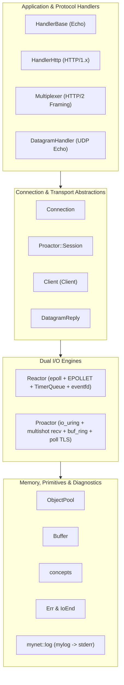

# mynet

[**English**](README.md) | [**中文简体**](README_zh.md)

[](https://en.cppreference.com/w/cpp/26)
[](https://kernel.org/)
[](#architecture)
[](LICENSE)

`mynet` is an ultra-high-performance, modern C++26 asynchronous network framework and protocol toolkit designed for Linux. Built from the ground up for microsecond-level latency, zero-copy/zero-allocation hot paths, and robust software engineering practices, `mynet` provides dual I/O engines (**Reactor** powered by edge-triggered `epoll` and **Proactor** powered by `io_uring` with kernel buffer rings), unified stream and datagram transports (TCP, TLS, UDP), an HTTP/2 wire-compatible stream multiplexer, and strongly-typed error semantics.

---

## Table of Contents

- [Key Features](#key-features)
- [Architecture](#architecture)
- [Core Components](#core-components)
  - [Dual I/O Engines: Reactor vs Proactor](#1-dual-io-engines-reactor-vs-proactor)
  - [Unified Connection & Session Ownership](#2-unified-connection--session-ownership)
  - [Zero-Allocation Memory Architecture](#3-zero-allocation-memory-architecture)
  - [HTTP/2 Framing & Stream Multiplexer](#4-http2-framing--stream-multiplexer)
  - [Datagram Transport (UDP)](#5-datagram-transport-udp)
  - [Modern C++26 & Strongly-Typed Error Semantics](#6-modern-c26--strongly-typed-error-semantics)
  - [Bidirectional Stream Client (Client)](#7-bidirectional-stream-client-client)
- [Benchmark Results](#benchmark-results)
- [Dependencies & Prerequisites](#dependencies--prerequisites)
- [Building & Installation](#building--installation)
- [Quick Start Guide](#quick-start-guide)
  - [1. Epoll-Based TCP Echo Server (Reactor)](#1-epoll-based-tcp-echo-server-reactor)
  - [2. io_uring TCP Server with Kernel Buffer Ring (Proactor)](#2-io_uring-tcp-server-with-kernel-buffer-ring-proactor)
  - [3. Multiplexed Stream Server](#3-multiplexed-stream-server)
  - [4. Unix-Philosophy Stdin/Stdout Client (Client)](#4-unix-philosophy-stdinstdout-client-client)
- [Project Layout](#project-layout)
- [Testing & Quality Assurance](#testing--quality-assurance)
- [License](#license)

---

## Key Features

- **Modern C++26 Paradigm**:
  - Leverages C++26 Preconditions / Contracts (`-fcontracts`) for strict caller assertion.
  - Informative compile-time deletion reasons via `= delete("reason")` (P2573R2).
  - Modern concepts & constraints (`std::derived_from`, `std::same_as`, custom requires clauses).
  - `std::expected` and `std::optional` return pathways eliminating magic numbers.
- **Dual Asynchronous Engines**:
  - **Reactor**: Edge-Triggered `epoll` (`EPOLLET`) with `eventfd` cross-thread wakeups and a lock-free/lazy-cancelling $O(1)$ priority timer queue.
  - **Proactor**: Pure asynchronous `io_uring` utilizing multishot accepts (`io_uring_prep_accept`), multishot receives (`io_uring_prep_recv_multishot`), kernel-managed registered buffer rings (`io_uring_setup_buf_ring`), and poll-driven TLS.
- **Zero-Allocation Hot Paths**:
  - Address-stable fixed-capacity `ObjectPool<T>` preventing memory reallocation and pointer invalidation during event dispatch.
  - Sliding-window auto-compacting `Buffer` designed for long-lived connections.
- **Transparent Security**:
  - First-class OpenSSL 3.x integration with zero code duplication between plain TCP and TLS pipelines.
  - Full support for ALPN negotiation, SNI host matching, and asynchronous TLS handshakes.
- **Protocol Engineering & Framing**:
  - HTTP/2 wire-compatible 9-byte frame codec (`Length:24`, `Type:8`, `Flags:8`, `StreamID:31`).
  - Generalized `Multiplexer<StreamHandler>` supporting concurrent stream management, priority, ping, reset, connection/stream-level flow control (`WINDOW_UPDATE`), and graceful `GOAWAY` teardown.
  - HTTP/1.x codec powered by `llhttp` supporting pipelining and keep-alive.
- **Observability & Operability**:
  - Exhaustive enum class error codes (`Err` and `IoEnd`).
  - Clean separation: data flows over stdout, structured diagnostic logging routes to `stderr` via `mynet::log` (wrapping submodule `mylog`), preventing stream pipeline corruption.

---

## Architecture

The following diagram illustrates the layered architecture of `mynet`:



---

## Core Components

### 1. Dual I/O Engines: Reactor vs Proactor

| Feature | Reactor (`Reactor<Event>`) | Proactor (`Proactor<Event>`) |
| :--- | :--- | :--- |
| **Kernel Subsystem** | Linux `epoll` (Edge-Triggered, `EPOLLET`) | Linux `io_uring` |
| **Notification Model** | Readiness Notification | Asynchronous Completion Notification |
| **Buffer Management** | Userspace `Buffer` per Connection | Kernel-managed registered buffer ring (`io_uring_buf_ring`) |
| **Syscall Overhead** | One `epoll_wait` + subsequent non-blocking `recv`/`send` | Batch completion via `io_uring_wait_cqe`, multishot syscall-free reads |
| **TLS Integration** | Direct non-blocking OpenSSL `SSL_read`/`SSL_write` | Poll-driven readiness mask (`io_uring_prep_poll_add`) to avoid ciphertext detachment |
| **Cross-Thread Dispatch** | `eventfd` wakeup + loop-bound task queue (`runInLoop`) | `std::stop_source` / submission ring scheduling |

### 2. Unified Connection & Session Ownership

`Connection<HandlerType>` unifies socket state, TLS encryption, protocol handling, and outgoing write queues:
- **Transport Symmetry**: Plain TCP and encrypted TLS share the same data path (`doRecv` / `doSend`). TLS is treated as a transport property rather than requiring a separate loop or wrapper.
- **Pipelining Safety**: Responses reside in an internal fixed-capacity `RingQueue<std::string>` write queue by value. Multiple responses generated from a single batch read are guaranteed to arrive in-order without dynamic allocations during enqueuing or overwriting shared buffers.
- **Backpressure**: Integrated high-watermark inspection and `readCredit()` hooks pause reads when downstream consumer queues become saturated.
- **Reference-Counted Lifetime in Proactor**: In `Proactor`, connections are wrapped inside `Session` structs tracking `inFlight` ring operations. Connections are never returned to the pool while the kernel has outstanding writes or reads.

### 3. Zero-Allocation Memory Architecture

- **`ObjectPool<Object>`**: Pre-allocates a contiguous array of slots via `std::unique_ptr<Slot[]>` with an index-based ring queue (`RingQueue<size_t>`). Objects are pinned in memory so epoll data pointers and io_uring completion context pointers remain 100% stable, completely bypassing heap allocation during connection accept/release cycles.
- **`Buffer`**: A zero-exception, self-managed contiguous byte buffer (`operator new[](std::nothrow)`) with sliding-window auto-compaction and direct zero-copy write window (`writableBytes()`, `writableBegin()`, `commitWritten()`, `ensureWritable()`, `readableView()`). Storage is compacted in-place only when dead prefix space exceeds 4 KiB and occupies at least half of the allocation, amortizing compaction overhead while keeping memory footprints bounded.
- **`RingQueue<T>`**: Fixed-capacity contiguous circular ring buffer (`src/ringQueue.hpp`) providing $O(1)$ zero-allocation enqueue/dequeue operations with bounded memory footprints.
- **`StreamTable<T>`**: Open-addressing flat hash table (`src/http/v2/streamTable.hpp`) with linear probing, tombstone deletion, and tombstone recycling, achieving zero runtime allocations for active stream management.

### 4. HTTP/2 Framing & Stream Multiplexer

- **Wire Compatibility**: `FrameDecoder` and `appendFrame` parse and construct 9-byte HTTP/2 standard frames (`DATA`, `HEADERS`, `PRIORITY`, `RST_STREAM`, `SETTINGS`, `PUSH_PROMISE`, `PING`, `GOAWAY`, `WINDOW_UPDATE`).
- **`Multiplexer<StreamHandler>`**: Enables many independent logical request/response streams over a single byte stream.
  - Implements credit-based flow control at both connection and stream levels.
  - Utilizes `mux::StreamTable<StreamSlot>` for zero-allocation stream lookups and lifecycles.
  - Automatically sends `WINDOW_UPDATE` frames when window thresholds drop below half.
  - Handles concurrent stream capacity limits via `SETTINGS_MAX_CONCURRENT_STREAMS` and rejects over-capacity requests with `RST_STREAM`.
  - Dispatches to individual `StreamHandler` instances sourced from an `ObjectPool`.

### 5. Datagram Transport (UDP)

- **`DatagramHandler`**: Unlike connected stream sockets, UDP sockets are connectionless and must handle interleaved peers on a single file descriptor. `DatagramHandler` associates peer addresses (`sockaddr_in`) directly with message buffers (`DatagramReply`).
- **Overload Handling**: Backed by a fixed-capacity `RingQueue<DatagramReply>`, dropping overflow datagrams with explicit metrics logging, preventing unbounded memory growth under sudden traffic spikes.

### 6. Modern C++26 & Strongly-Typed Error Semantics

- **No Magic Numbers**:
  - `enum class ERR : uint8_t`: Comprehensive, library-wide runtime errors (`ADDR_INVALID`, `SOCKET_FAILED`, `SSL_CTX_FAILED`, `URING_BUF_RING_FAILED`, etc.) returned via `Result<T = void>` (`std::expected<T, ERR>`).
  - `enum class IO_END : uint8_t`: Explicit, non-error I/O state explanations (`WOULDBLOCK`, `INTERRUPTED`, `EOF_REACHED`, `FATAL`) returned via `std::expected<size_t, IO_END>`.
- **Precondition Contracts**: Contract violations (`contract_assert`) catch programmer errors (e.g., null pointers, out-of-range port numbers) at translation boundaries.

### 7. Bidirectional Stream Client (Client)

`Client<Event>` is an idiomatic Unix-style pipeline client bridging stdin/stdout and network sockets:
```bash
cat request.bin | ./client_tcp 127.0.0.1 8888 > response.bin
```
Features watermark-based backpressure for stdin, graceful TCP/TLS half-close forwarding (`close_notify` / `SHUT_WR`), signal-safe blocking of `SIGPIPE`, and detection of regular file vs interactive terminal descriptors.

---

## Benchmark Results

Benchmarks run on Linux (x86_64, GCC 15, Release build `-O2`, single process, with logging redirected away from the measurement path):

```text
benchmark                                      latency        throughput
--------------------------------------------------------------------------------
Buffer::append+retrieveAll (1KiB)              12.7 ns/op    80,477.0 MB/s
Buffer::append (16B) to 1KiB + drain            2.5 ns/op             --
Buffer::append+retrieve (16B)                   4.0 ns/op     4,041.9 MB/s
appendFrame (payload 16B)                       4.5 ns/op     3,555.4 MB/s
appendFrame (payload 1024B)                    12.3 ns/op    83,077.8 MB/s
appendFrame (payload 16384B)                  223.4 ns/op    73,328.8 MB/s
FrameDecoder::next (payload 16B)               12.6 ns/op     1,268.1 MB/s
FrameDecoder::next (payload 1024B)             77.5 ns/op    13,216.9 MB/s
FrameDecoder::next (payload 16384B)          1104.7 ns/op    14,831.4 MB/s
read+appendBigEndian32                          0.7 ns/op             --
ObjectPool acquire+release (128)                3.8 ns/op             --
HandlerBase::pushResponse+takeResponse (1KiB)  22.5 ns/op    45,605.2 MB/s
HandlerBase::process echo (1KiB)               47.1 ns/op    21,760.2 MB/s
Multiplexer open+echo+close (64 streams)      553.4 ns/op             --
```

---

## Dependencies & Prerequisites

- **Operating System**: Linux (Kernel >= 5.19 recommended for full `io_uring` buffer ring and multishot support).
- **C++ Compiler**: GCC 14+ or GCC 15+ with C++26 and `-fcontracts` support.
- **Build System**: CMake >= 3.25.
- **System Libraries**:
  - `liburing-dev` (>= 2.2)
  - `libssl-dev` (OpenSSL 3.x)
  - `libgtest-dev` (Google Test, for unit tests)
  - `pkg-config`
  - `llhttp`

On Debian/Ubuntu 25.10+:
```bash
sudo apt-get update
sudo apt-get install -y g++ cmake make pkg-config libssl-dev liburing-dev libgtest-dev libpq-dev
```

---

## Building & Installation

### 1. Clone the Repository (with Submodules)

```bash
git clone --recurse-submodules https://github.com/printf033/mynet.git
cd mynet
```
If already cloned without submodules:
```bash
git submodule update --init --recursive
```

### 2. Configure & Build with CMake

```bash
mkdir -p build && cd build
cmake -DCMAKE_BUILD_TYPE=Release ..
make -j$(nproc)
```

### 3. CMake Configuration Options

| Option | Default | Description |
| :--- | :--- | :--- |
| `CMAKE_BUILD_TYPE` | `Debug` | Build profile (`Debug`, `Release`, `RelWithDebInfo`) |
| `BUILD_TESTING` | `ON` | Build Google Test unit test executables |
| `MYNET_BUILD_BENCH` | `ON` | Build micro-benchmark executables (`bench/bench`) |

### 4. Docker Quickstart

A multi-stage `Dockerfile` based on Ubuntu 25.10 is included in the root directory:
```bash
docker build -t mynet:latest .
docker run --rm -it -p 8888:8888 mynet:latest
```

---

## Quick Start Guide

### 1. Epoll-Based TCP Echo Server (Reactor)

```cpp
#include "error.hpp"
#include "handler.hpp"
#include "log.hpp"
#include "reactor.hpp"

using namespace mynet;

int main() {
    mynet::log::init(); // Directs logs to stderr

    // Instantiate a Reactor with plain socket events and an echo handler
    Reactor<EventSocket<HandlerBase>> server;

    if (auto res = server.runTcp("0.0.0.0", 8888); !res) {
        LOG_ERROR("Server failed: {}", toString(res.error()));
        return toExitCode(res.error());
    }
    return 0;
}
```

### 2. io_uring TCP Server with Kernel Buffer Ring (Proactor)

```cpp
#include "error.hpp"
#include "handler.hpp"
#include "log.hpp"
#include "proactor.hpp"

using namespace mynet;

int main() {
    mynet::log::init();

    // Instantiate a Proactor using io_uring multishot accept & multishot recv
    Proactor<EventSocket<HandlerBase>> server;

    // Parameters: IP, Port, backlog, SQ entries, CQ entries, max accept ops, session pool, buf ring count, buf size
    if (auto res = server.runTcp("0.0.0.0", 8888, 511, 512, 1024, 256, 512, 1024, 4096); !res) {
        LOG_ERROR("Proactor failed: {}", toString(res.error()));
        return toExitCode(res.error());
    }
    return 0;
}
```

### 3. Multiplexed Stream Server

```cpp
#include "error.hpp"
#include "handler.hpp"
#include "http/v2/multiplexer.hpp"
#include "reactor.hpp"

using namespace mynet;

int main() {
    mynet::log::init();

    // Stack: Reactor -> Socket -> Multiplexer (HTTP/2 framing) -> Trace Echo Handler
    Reactor<EventSocket<Multiplexer<HandlerBase>>> server;

    if (auto res = server.runTcp("0.0.0.0", 8888); !res) {
        LOG_ERROR("Multiplexer server failed: {}", toString(res.error()));
        return toExitCode(res.error());
    }
    return 0;
}
```

### 4. Unix-Philosophy Stdin/Stdout Client (Client)

```cpp
#include "error.hpp"
#include "handler.hpp"
#include "client.hpp"

using namespace mynet;

int main(int argc, char* argv[]) {
    mynet::log::init();
    Client<EventSocket<HandlerBase>> client;

    // Connects to target server, streams stdin -> server and server -> stdout
    if (auto res = client.runTcp("127.0.0.1", 8888); !res) {
        LOG_ERROR("Client error: {}", toString(res.error()));
        return toExitCode(res.error());
    }
    return 0;
}
```

Usage with standard Linux utilities:
```bash
# Send an HTTP request and inspect output
printf "GET / HTTP/1.1\r\nHost: localhost\r\n\r\n" | ./build/client_tcp 127.0.0.1 8888
```

---

## Project Layout

```text
mynet/
├── CMakeLists.txt              # Top-level CMake configuration (C++26 standard, contracts)
├── Dockerfile                  # Multi-stage containerized build configuration
├── LICENSE                     # MIT License
├── README.md                   # English Documentation
├── README_zh.md                # Chinese Documentation
│
├── src/                        # Core Header-Only Implementation
│   ├── CMakeLists.txt          # Header-only interface library definition (INTERFACE mynet)
│   ├── concepts.hpp            # C++20/C++26 Concept constraints
│   ├── error.hpp               # Strongly-typed Err & IoEnd definitions
│   ├── log.hpp                 # Logging facade (mylog -> stderr)
│   ├── buffer.hpp              # Low-allocation auto-compacting byte buffer
│   ├── ringQueue.hpp           # Zero-allocation fixed-capacity circular ring queue
│   ├── objectPool.hpp          # Fixed-capacity stable-pointer object pool
│   ├── timer.hpp               # Lazy-cancellation binary min-heap timer queue
│   ├── loop.hpp                # epoll EventLoop with eventfd wakeups
│   ├── event.hpp               # Socket & SSL listener abstractions
│   ├── connection.hpp          # Unified TCP/TLS connection engine with write queue
│   ├── datagram.hpp            # Datagram transport abstraction (UDP)
│   ├── handler.hpp             # HandlerBase and HandlerDatagramEcho base handlers
│   ├── http/                   # HTTP protocol implementations
│   │   ├── v1/
│   │   │   └── handler.hpp     # HTTP/1.x protocol handler (HandlerHttp)
│   │   └── v2/
│   │       ├── frame.hpp       # HTTP/2 wire-compatible framing codec
│   │       ├── streamTable.hpp # Open-addressing zero-allocation stream hash table
│   │       ├── multiplexer.hpp # HTTP/2 credit-based stream multiplexer
│   │       └── handler.hpp     # HTTP/2 protocol handler entry (HandlerHttp2)
│   ├── reactor.hpp             # epoll-based Edge-Triggered Reactor engine
│   ├── proactor.hpp            # io_uring-based completion Proactor engine
│   └── client.hpp              # Pipeline client abstraction (stdin/stdout bridge)
│
├── examples/                   # Ready-to-run Executable Samples
│   ├── reactor_tcp.cpp         # Reactor TCP echo server
│   ├── reactor_ssl.cpp         # Reactor TLS server
│   ├── reactor_udp.cpp         # Reactor UDP echo server
│   ├── reactor_multiplex.cpp   # Reactor stream multiplexer server
│   ├── proactor_tcp.cpp        # Proactor TCP server with buffer ring
│   ├── proactor_ssl.cpp        # Proactor TLS server (poll-driven)
│   ├── proactor_udp.cpp        # Proactor UDP server
│   ├── proactor_multiplex.cpp  # Proactor stream multiplexer server
│   ├── client_tcp.cpp          # Stdin/stdout TCP client
│   ├── client_ssl.cpp          # Stdin/stdout TLS client
│   └── client_udp.cpp          # Stdin/stdout UDP client
│
├── tests/                      # Unit Test Suite (Google Test + ASan)
│   ├── test_buffer.cpp
│   ├── test_concepts.cpp
│   ├── test_error.cpp
│   ├── test_frame.cpp
│   ├── test_handler.cpp
│   ├── test_multiplexer.cpp
│   ├── test_object_pool.cpp
│   └── test_timer.cpp
│
├── bench/                      # Micro-benchmark Suite
│   └── bench.cpp               # Throughput and latency micro-benchmarks
│
├── certs/                      # Development self-signed certificates and keys
├── scripts/                    # Maintenance & formatting scripts
└── thirdparty/                 # External Git Submodules (mylog)
```

---

## Testing & Quality Assurance

All unit tests are compiled with **AddressSanitizer (ASan)** and `-Wall -Wextra -Wpedantic` to guarantee memory safety and contract conformance:

```bash
cd build
ctest --output-on-failure
```

Output:
```text
Test project /home/aaa/code/mynet/build
    Start 1: test_buffer
1/8 Test #1: test_buffer ......................   Passed    0.01 sec
    Start 2: test_concepts
2/8 Test #2: test_concepts ....................   Passed    0.01 sec
    Start 3: test_error
3/8 Test #3: test_error .......................   Passed    0.01 sec
    Start 4: test_frame
4/8 Test #4: test_frame .......................   Passed    0.01 sec
    Start 5: test_handler
5/8 Test #5: test_handler .....................   Passed    0.01 sec
    Start 6: test_multiplexer
6/8 Test #6: test_multiplexer .................   Passed    0.02 sec
    Start 7: test_object_pool
7/8 Test #7: test_object_pool .................   Passed    0.01 sec
    Start 8: test_timer
8/8 Test #8: test_timer .......................   Passed    0.02 sec

100% tests passed out of 8
```

---

## License

`mynet` is released under the **MIT License**. See [LICENSE](LICENSE) for details.
