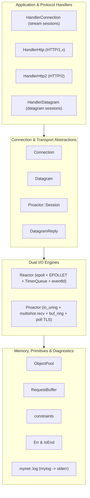

# mynet

[](https://en.cppreference.com/w/cpp/26)
[](https://kernel.org/)
[](#architecture)
[](LICENSE)

[**English**](README.md) | [**中文简体**](README_zh.md)

`mynet` is an ultra-high-performance, modern C++26 asynchronous network framework and protocol toolkit designed for Linux. Built from the ground up for microsecond-level latency, zero-copy/zero-allocation hot paths, and robust software engineering practices, `mynet` provides dual I/O engines (**Reactor** powered by edge-triggered `epoll` and **Proactor** powered by `io_uring` with kernel buffer rings), unified stream and datagram transports (TCP, TLS, UDP), an HTTP/2 wire-compatible stream multiplexer, and strongly-typed error semantics.

---

## Table of Contents

- [Key Features](#key-features)
- [Architecture](#architecture)
- [Core Components](#core-components)
  - [Dual I/O Engines: Reactor vs Proactor](#1-dual-io-engines-reactor-vs-proactor)
  - [Unified Connection &amp; Session Ownership](#2-unified-connection--session-ownership)
  - [Zero-Allocation Memory Architecture](#3-zero-allocation-memory-architecture)
  - [HTTP/2 Framing &amp; Stream Multiplexer](#4-http2-framing--stream-multiplexer)
  - [Datagram Transport (UDP)](#5-datagram-transport-udp)
  - [Modern C++26 &amp; Strongly-Typed Error Semantics](#6-modern-c26--strongly-typed-error-semantics)
  - [Configuration Ownership](#7-configuration-ownership-no-hard-coded-engine-defaults)
- [Benchmark Results](#benchmark-results)
- [Dependencies &amp; Prerequisites](#dependencies--prerequisites)
- [Building &amp; Installation](#building--installation)
- [Quick Start Guide](#quick-start-guide)
  - [1. Epoll-Based TCP Echo Server (Reactor)](#1-epoll-based-tcp-echo-server-reactor)
  - [2. io_uring TCP Server with Kernel Buffer Ring (Proactor)](#2-io_uring-tcp-server-with-kernel-buffer-ring-proactor)
  - [3. Multiplexed Stream Server](#3-multiplexed-stream-server)
- [Project Layout](#project-layout)
- [Testing &amp; Quality Assurance](#testing--quality-assurance)
- [License](#license)

---

## Key Features

- **Modern C++26 Paradigm**:
  - Leverages C++26 Preconditions / Contracts (`-fcontracts`) for strict caller assertion.
  - Informative compile-time deletion reasons via `= delete("reason")` (P2573R2).
  - Modern concepts & constraints (`std::derived_from`, `std::same_as`, custom requires clauses).
  - `std::expected` and `std::optional` return pathways eliminating magic numbers.
- **Dual Asynchronous Engines**:
  - **Reactor**: Edge-Triggered `epoll` (`EPOLLET`) with `eventfd` cross-thread wakeups and a lock-free/lazy-cancelling $O(1)$ priority timer queue.
  - **Proactor**: Pure asynchronous `io_uring` utilizing multishot accepts (`io_uring_prep_accept`), multishot receives (`io_uring_prep_recv_multishot`), kernel-managed registered buffer rings (`io_uring_setup_buf_ring`), and poll-driven TLS.
- **Zero-Allocation Hot Paths**:
  - Address-stable fixed-capacity `ObjectPool<T>` preventing memory reallocation and pointer invalidation during event dispatch.
  - Sliding-window auto-compacting `RequestBuffer` designed for long-lived connections.
- **Extreme Zero-Copy Data Pipelines**:
  - Linux `splice(2)` kernel-level zero-copy looping: a handler that declares `kEnableSplice = true` gets an in-kernel non-blocking pipe buffer (`socket -> pipe -> socket`) on plain TCP, delivering 0 user-space copies and 0 kernel memory copies (`SpliceEchoHandler` in `examples/common/handlers.hpp` shows the opt-in).
  - Direct writable ingress: connections read directly into pre-allocated `RequestBuffer` write windows via `prepareRequestWritable`, eliminating stack scratch buffers and intermediary `memcpy`.
  - Vectorized scatter-gather I/O: plain connections aggregate up to 16 response segments per single `writev(2)` syscall.
- **Transparent Security**:
  - First-class OpenSSL 3.x integration with zero code duplication between plain TCP and TLS pipelines.
  - Full support for ALPN negotiation, SNI host matching, and asynchronous TLS handshakes.
- **Protocol Engineering & Framing**:
  - HTTP/2 wire-compatible 9-byte frame codec (`Length:24`, `Type:8`, `Flags:8`, `StreamID:31`).
  - RFC 7541 HPACK header compression (static/dynamic tables and Huffman decoding) plus RFC 9113 client connection-preface validation, so `curl --http2-prior-knowledge` and `nghttp` interoperate end to end.
  - Generalized `HandlerHttp2<StreamHandler>` supporting concurrent stream management, priority, ping, reset, connection/stream-level flow control (`WINDOW_UPDATE`), and graceful `GOAWAY` teardown.
  - HTTP/1.x codec powered by `llhttp` supporting pipelining and keep-alive.
- **Observability & Operability**:
  - Exhaustive enum class error codes (`Err` and `IoEnd`).
  - Clean separation: data flows over stdout, structured diagnostic logging routes to `stderr` via `mynet::log` (wrapping submodule `mylog`), preventing stream pipeline corruption.
  - **Sandboxed Lua Hot-Configuration & Lockless Snapshots**: `mynet::reloadConfig("config/config.lua")` executes in a bare `lua_State` (no standard libraries like `os`/`io` to prevent code injection) with an instruction budget limit of 50M steps; supports transactional validation (All-or-Nothing) and value clamping. Backed by `ConfigHolder` and `ConfigSnapshot` for lock-free read-paths, and seamlessly synchronizes with `mylog`'s logging configuration in a unified config file.

---

## Architecture

The following diagram illustrates the layered architecture of `mynet`:



---

## Core Components

### 1. Dual I/O Engines: Reactor vs Proactor

| Feature                         | Reactor (`Reactor<Event>`)                                   | Proactor (`Proactor<Event>`)                                                         |
| :------------------------------ | :------------------------------------------------------------- | :------------------------------------------------------------------------------------- |
| **Kernel Subsystem**      | Linux `epoll` (Edge-Triggered, `EPOLLET`)                  | Linux `io_uring`                                                                     |
| **Notification Model**    | Readiness Notification                                         | Asynchronous Completion Notification                                                   |
| **Buffer Management**     | Userspace `RequestBuffer` per Connection                     | Kernel-managed registered buffer ring (`io_uring_buf_ring`)                          |
| **Syscall Overhead**      | One `epoll_wait` + subsequent non-blocking `recv`/`send` | Batch completion via `io_uring_wait_cqe`, multishot syscall-free reads               |
| **TLS Integration**       | Direct non-blocking OpenSSL `SSL_read`/`SSL_write`         | Poll-driven readiness mask (`io_uring_prep_poll_add`) to avoid ciphertext detachment |
| **Cross-Thread Dispatch** | `eventfd` wakeup + loop-bound task queue (`runInLoop`)     | `std::stop_source` / submission ring scheduling                                      |

### 2. Unified Connection & Session Ownership

`Connection<HandlerType>` unifies socket state, TLS encryption, protocol handling, and outgoing write queues:

- **Transport Symmetry**: Plain TCP and encrypted TLS share the same data path (`doRecv` / `doSend`). TLS is treated as a transport property rather than requiring a separate loop or wrapper.
- **Pipelining Safety**: Responses reside in an internal fixed-capacity `ResponseQueue` write queue by value. Multiple responses generated from a single batch read are guaranteed to arrive in-order without dynamic allocations during enqueuing or overwriting shared buffers.
- **Backpressure**: Integrated high-watermark inspection and `readCredit()` hooks pause reads when downstream consumer queues become saturated.
- **Reference-Counted Lifetime in Proactor**: In `Proactor`, connections are wrapped inside `Session` structs tracking `inFlight` ring operations. Connections are never returned to the pool while the kernel has outstanding writes or reads.
- **Handler Layering**: `HandlerConnection` (`connection.hpp`) and `HandlerDatagram` (`datagram.hpp`) are two peer base classes with no shared ancestor: the former owns the request buffer, response queue and read-credit backpressure for stream sessions, the latter the peer-tagged reply queue for connectionless datagrams. Protocol handlers (`HandlerHttp`, `HandlerHttp2`, `HandlerHttp3`) derive from these; a handler that needs both transports (`HandlerHttp3`) inherits both, and since neither base is virtual there is no virtual-base indirection or shared subobject bookkeeping on member access. The contract that used to sit in a common root — `reset`, `onMessageComplete`, `onParseError` — now lives on each base class and, transport-agnostically, in the `HandlerConstraint` concept (`constraints.hpp`), which is all the acceptor slots require (the object pool needs only `Resettable`). The two engine contracts are named for what they are — the mandatory method set each transport actually calls: `MandatoryMethodConnection` (`connection.hpp`) and `MandatoryMethodDatagram` (`datagram.hpp`). Each lives beside its own base class so `std::derived_from` always sees a complete type, and each requires derivation plus validates the signatures the engine calls through the handler type itself. A datagram-only handler needs `HandlerDatagram` alone: the engines map non-streaming handlers to a stateless `NoConnection` slot (`ConnectionSlot`) and stream-only handlers to a `NoDatagram` slot (`DatagramSlot`), so neither path instantiates the other transport's machinery.

### 3. Zero-Allocation Memory Architecture

- **`ObjectPool<Object>`**: Pre-allocates a contiguous array of slots via `std::unique_ptr<Slot[]>` with an index-based free stack. Objects are pinned in memory so epoll data pointers and io_uring completion context pointers remain 100% stable, completely bypassing heap allocation during connection accept/release cycles.
- **`RequestBuffer`**: A zero-exception, self-managed contiguous byte buffer (`operator new[](std::nothrow)`) with sliding-window auto-compaction and direct zero-copy write window (`writableBytes()`, `writableBegin()`, `commitWritten()`, `ensureWritable()`, `readableView()`). Storage is compacted in-place only when dead prefix space exceeds 4 KiB and occupies at least half of the allocation, amortizing compaction overhead while keeping memory footprints bounded.
- **`ResponseQueue`**: Fixed-capacity contiguous circular ring buffer (`src/responseQueue.hpp`) providing $O(1)$ zero-allocation enqueue/dequeue operations with bounded memory footprints.
- **`StreamTable<T>`**: Open-addressing flat hash table (`src/http/v2/streamTable.hpp`) with linear probing, tombstone deletion, and tombstone recycling, achieving zero runtime allocations for active stream management.

### 4. HTTP/2 Framing & Stream Multiplexer

- **Wire Compatibility**: `FrameDecoder` and `appendFrame` parse and construct 9-byte HTTP/2 standard frames (`DATA`, `HEADERS`, `PRIORITY`, `RST_STREAM`, `SETTINGS`, `PUSH_PROMISE`, `PING`, `GOAWAY`, `WINDOW_UPDATE`).
- **Client Connection Preface**: the 24-byte RFC 9113 §3.4 preface is validated before any frame is decoded (it may arrive split across reads); a wrong preface is answered with `GOAWAY(PROTOCOL_ERROR)` instead of being misparsed as a 5 MiB frame.
- **HPACK (`http/v2/hpack.hpp`)**: RFC 7541 decoding — static table, dynamic table with eviction, table-size updates and Huffman strings — plus a stateless encoder used by `sendResponse`. Compression failures end the connection with `COMPRESSION_ERROR`; an over-large header list resets only that stream.
- **Fragmented Header Blocks**: `HEADERS` without `END_HEADERS` is assembled from same-stream `CONTINUATION` frames (fragment boundaries may fall inside an HPACK field). Per RFC 9113 §6.2 any interleaved frame — including one on another stream — ends the connection, which is also the CVE-2024-27983 defense; a zero-length `CONTINUATION` flood hits a 32-empty-frame cap (total fragments capped at 4096), and a header list that decodes past the advertised limit is answered with `RST_STREAM` — the block is still fully HPACK-decoded first, so the connection's dynamic table never desynchronises.
- **Header List Limits**: `sendSettings` advertises `SETTINGS_MAX_HEADER_LIST_SIZE` with the same value the decoder enforces, so a compliant peer never trips the limit mid-block. The peer's advertised limit is honoured on the way out: `sendResponse` refuses a header list the peer said it will not accept, and outbound `HEADERS` are split into `CONTINUATION` frames by the peer's `SETTINGS_MAX_FRAME_SIZE`.
- **`HandlerHttp2<StreamHandler>`**: Enables many independent logical request/response streams over a single byte stream.
  - `onStreamHeadersDecoded` delivers decoded pseudo-headers; `onStreamEnd` fires when a request body is complete.
  - `sendResponse(streamId, status, body, extra)` encodes `:status` and sends the response through the existing flow-control path.
  - Implements credit-based flow control at both connection and stream levels.
  - Utilizes `mux::StreamTable<StreamSlot>` for zero-allocation stream lookups and lifecycles.
  - Automatically sends `WINDOW_UPDATE` frames when window thresholds drop below half.
  - Handles concurrent stream capacity limits via `SETTINGS_MAX_CONCURRENT_STREAMS` and rejects over-capacity requests with `RST_STREAM`.
  - Dispatches to individual `StreamHandler` instances sourced from an `ObjectPool`.

### 5. Datagram Transport (UDP)

- **`HandlerDatagram`**: Unlike connected stream sockets, UDP sockets are connectionless and must handle interleaved peers on a single file descriptor. `HandlerDatagram` associates peer addresses (`sockaddr_in`) directly with message buffers (`DatagramReply`). It is the protocol-side root: it only decides *what* to reply.
- **`Datagram<Handler>`**: The transport-side counterpart of `Connection<Handler>` on the UDP path (`datagram.hpp`). It binds one handler to one socket and owns the fixed-capacity receive window plus the send/receive counters; truncation against `maxDatagramBytes()` and reply draining live here, so both engines shrink to event dispatch (recvfrom into `recvBuffer()`, hand it to `receiveFrom()`, drain with `flushTo()`). It deliberately carries no fd, no peer address and no write queue — UDP is connectionless, so those would be per-datagram state, not per-session state. Its receive/send counters are diagnostic scaffolding for unit tests, not production metrics: `runUdp` calls `reset()` before returning and no accessor exposes the session, so they are not observable from a running server. `DatagramSlot<H>` picks `Datagram<H>` or the inert `NoDatagram` at compile time, mirroring `ConnectionSlot` on the stream side.
- **Overload Handling**: Bounded by `maxPendingReplies`; once the reply queue is full, further datagrams are dropped with explicit metrics logging, preventing unbounded memory growth under sudden traffic spikes.

### 6. Modern C++26 & Strongly-Typed Error Semantics

- **No Magic Numbers**:
  - `enum class ERR : uint8_t`: Comprehensive, library-wide runtime errors (`ADDR_INVALID`, `SOCKET_FAILED`, `SSL_CTX_FAILED`, `URING_BUF_RING_FAILED`, etc.) returned via `Result<T = void>` (`std::expected<T, ERR>`).
  - `enum class IO_END : uint8_t`: Explicit, non-error I/O state explanations (`WOULDBLOCK`, `INTERRUPTED`, `EOF_REACHED`, `FATAL`) returned via `std::expected<size_t, IO_END>`.
- **Precondition Contracts**: Contract violations (`contract_assert`) catch programmer errors (e.g., null pointers, out-of-range port numbers) at translation boundaries.

### 7. Configuration Ownership: No Hard-Coded Engine Defaults

Every tunable that decides *how much* a server engine allocates or how deep its kernel queues run lives in exactly one place: `configHolder.hpp` (the compiled-in baseline) parsed and clamped by `config/config.lua` via `reloadConfig()`. `Reactor` and `Proactor` carry no default arguments of their own — the two-argument call reads the current `NetConfig` snapshot:

```cpp
// Nothing is loaded for you: the baseline in configHolder.hpp is what a fresh
// process already has. Call this once at startup to apply config/config.lua.
mynet::reloadConfig("config/config.lua");

// Fully from config: host and port come from server.host / server.port.
server.runTcp();

// Explicit endpoint, configuration still from the snapshot.
server.runTcp("0.0.0.0", 8888);

// Everything explicit; the same validation contracts apply.
ReactorConfig reactorCfg = mynet::getReactorConfig();
reactorCfg.maxEvents = 2048;
server.runTcp("0.0.0.0", 8888, mynet::getServerConfig(), reactorCfg);

// TLS: runSsl() takes certFile / keyFile from the security section and refuses
// to start when they are unset; runSsl(crt, key) keeps the configured endpoint.
tlsServer.runSsl();
```

Without that `reloadConfig()` call the library still runs, on the compiled-in baseline — which is exactly the same value set the shipped `config.lua` carries (a test enforces it field by field). What a reader should *not* assume is that editing `config.lua` alone changes a running server.

Every field also declares **when** it takes effect, and that declaration is data, not documentation: `kConfigReloadMap` in `configHolder.hpp` maps every dotted path to a `ReloadMode`, and a test enumerates `NetConfig` by static reflection to prove no field is missing from it.

- **`Hot`** — picked up by `reloadConfig()` immediately. The reading site is on a per-connection or per-I/O path (`Connection`, `Datagram`, `HandlerHttp2`), so new connections and in-flight I/O see the new value right away.
- **`Startup`** — read once inside `listen()` / `serve()` / `runSsl()`. `reloadConfig()` updates the snapshot, but a running engine keeps the values it started with; restart the server to apply.

| Section | Fields | Effect |
| :------ | :----- | :----- |
| `server` | `host`, `port`, `backlog`, `maxConnections`, `idleTimeoutSecs` | Startup |
| `server` | `tcpNoDelay`, `tcpQuickAck`, `enableSplice` | Hot |
| `reactor` | `maxEvents`, `idleSweepIntervalMs` | Startup |
| `proactor` | `sqEntries`, `cqEntries`, `maxAcceptEvents`, `bufEntries`, `bufSize`, `udpBufSize`, `bufRingAlignment`, `cqeWaitMs` | Startup |
| `connection` | `responseCapacity`, `readChunkSize`, `maxRequestBytes`, `writeHighWaterMark`, `writeHardCapFactor`, `spliceChunkSize`, `maxWriteIov` | Hot |
| `datagram` | `maxDatagramBytes`, `maxPendingOutgoing` | Hot |
| `http2` | `maxConcurrentStreams`, `initialWindowSize`, `maxFrameSize` | Hot |
| `security` | `certFile`, `keyFile`, `caFile`, `ciphers`, `alpnProtocols` | Startup |

`server.maxConnections` is the single source of truth for capacity: the Reactor sizes its connection pool from it and the Proactor its session pool. `server.host`/`port` are consumed by the zero-argument `runTcp()` / `runSsl()`, and `security.certFile`/`keyFile` by `runSsl()` with no path arguments — that overload refuses to start rather than silently falling back to plaintext when the paths are unset.

Collapsing two sources of truth into one necessarily picks one of the two numbers. Two defaults therefore moved, and they are stated here rather than left for a surprised operator to discover:

- **listen backlog `511` → `128`** — `runTcp`/`runSsl` used to default to `511` while `config.lua` already documented `128`. The documented value won.
- **Proactor `sqEntries` `512` → `2048`, and `cqEntries` is now a separate knob defaulting to `2048`** — the engine used to default to `sq=512`/`cq=1024`, while `config.lua` documented `sq=2048`. The documented value won, and `cq` became configurable instead of being fixed at `2 × sq`.
- **Pool sizing moved to `server.maxConnections`** — `reactor.connectionPoolSize` and `proactor.sessionPoolSize` were two names for one concept and are gone. The default is `8192`, versus the old Reactor pool of `1024` and Proactor session pool of `512`. This is a **preallocated** slot count, not a growable ceiling: measured cost is ≈ 3 KiB per slot, so `8192` costs ≈ 24–26 MiB of RSS at startup and `65536` ≈ 190 MiB. (Measured on both the plaintext echo and the HTTP/2 handler; HTTP/2 stream pools are allocated lazily, so heavy multiplexing adds on top.) The `65536` that `config.lua` used to document was never allocated — it was a write-only field — so it is not the new default.

The public engine signatures also changed, which matters if you call them directly: `Reactor::serve(size_t,int,int)` → `serve(const ServerConfig&, const ReactorConfig&)`, `Reactor::serveDatagram(int)` → `serveDatagram(const ReactorConfig&)`, `Proactor::serve(...)` → `serve(const ServerConfig&, const ProactorConfig&, bool)`, and `Event::listenTcp` lost its `backlog = 511` default argument. Every in-repo call site was updated; downstream code fails at compile time rather than changing behaviour silently.

Four aliases that existed only to feed a duplicate of another field were removed outright: `server.keepAliveTimeout_ms` (superseded by `server.idleTimeoutSecs`), `server.writeHighWaterMark` / `server.maxRequestBytes` (the `connection` section is the consumer), `security.enableTls` (which `runSsl` you call is a compile-time choice), and `multiplexer.maxHeaderListSize` (no enforcement existed behind it). Nothing that was previously honoured was dropped. Each removed field was either never read at all, or read only to populate another field that itself had no consumer (`server.writeHighWaterMark` / `server.maxRequestBytes` were copied into the `connection` section by the parser, and the `connection` section is what the engine actually reads) — a chain of aliases ending nowhere.

ALPN deserves its own note. It is **not** enabled by default: `security.alpnProtocols = ""` means `runSsl` installs no ALPN selection callback, exactly as before this refactor. Set it only when the handler actually speaks the advertised protocol — an echo server that advertises `h2` is lying to its clients.

Ciphers follow the same "don't override what you weren't asked to change" rule. An empty `security.ciphers` (the default) — and the literal `"DEFAULT"` — are both normalized to *not calling* `SSL_CTX_set_cipher_list`. That matters beyond pedantry: explicitly setting `"DEFAULT"` replaces the `system_default` cipher string libssl read from `openssl.cnf`, silently discarding a hardening policy. Leaving it empty keeps that policy in force.

Two properties are enforced in mechanism rather than by convention. `validReactorConfig()` / `validProactorConfig()` are `constexpr` predicates asserted at every engine entry point — and at both `publish*Config()` entry points — so a non-runnable configuration aborts at the call site instead of surfacing as a mysterious `EPOLL`/`EINVAL` later. And `proactor.cqEntries < proactor.sqEntries` — which the kernel rejects with `-EINVAL` under `IORING_SETUP_CQSIZE` — is raised to `sqEntries` during parsing, because two individually valid numbers must not be allowed to compose into an unbootable engine.

---

## Benchmark Results

Benchmarks run on Linux (x86_64, GCC 15, Release build `-O2`, single process, with logging redirected away from the measurement path):

```text
benchmark                                      latency        throughput
--------------------------------------------------------------------------------
RequestBuffer::append+reset (1KiB)              12.7 ns/op    80,477.0 MB/s
RequestBuffer::append (16B) to 1KiB + drain            2.5 ns/op             --
RequestBuffer::append+retrieve (16B)                   4.0 ns/op     4,041.9 MB/s
appendFrame (payload 16B)                       4.5 ns/op     3,555.4 MB/s
appendFrame (payload 1024B)                    12.3 ns/op    83,077.8 MB/s
appendFrame (payload 16384B)                  223.4 ns/op    73,328.8 MB/s
FrameDecoder::next (payload 16B)               12.6 ns/op     1,268.1 MB/s
FrameDecoder::next (payload 1024B)             77.5 ns/op    13,216.9 MB/s
FrameDecoder::next (payload 16384B)          1104.7 ns/op    14,831.4 MB/s
read+appendBigEndian32                          0.7 ns/op             --
ObjectPool acquire+release (128)                3.8 ns/op             --
HandlerConnection::pushResponse+takeResponse (1KiB)  22.5 ns/op    45,605.2 MB/s
HandlerConnection::process echo (1KiB)               47.1 ns/op    21,760.2 MB/s
HandlerHttp2 open+echo+close (64 streams)            553.4 ns/op             --
```

---

## Dependencies & Prerequisites

- **Operating System**: Linux (Kernel >= 5.19 recommended for full `io_uring` buffer ring and multishot support).
- **C++ Compiler**: GCC 14+ or GCC 15+ with C++26 and `-fcontracts` support.
- **Build System**: CMake >= 3.25.
- **System Libraries**:
  - `liburing-dev` (>= 2.2)
  - `libssl-dev` (OpenSSL 3.x)
  - `libgtest-dev` (Google Test, for unit tests)
  - `pkg-config`
  - `llhttp`

On Debian/Ubuntu 25.10+:

```bash
sudo apt-get update
sudo apt-get install -y g++ cmake make pkg-config libssl-dev liburing-dev libgtest-dev libpq-dev
```

---

## Building & Installation

### 1. Clone the Repository (with Submodules)

```bash
git clone --recurse-submodules https://github.com/printf033/mynet.git
cd mynet
```

If already cloned without submodules:

```bash
git submodule update --init --recursive
```

### 2. Configure & Build with CMake

```bash
mkdir -p build && cd build
cmake -DCMAKE_BUILD_TYPE=Release ..
make -j$(nproc)
```

### 3. CMake Configuration Options

| Option                | Default   | Description                                                |
| :-------------------- | :-------- | :--------------------------------------------------------- |
| `CMAKE_BUILD_TYPE`  | `Debug` | Build profile (`Debug`, `Release`, `RelWithDebInfo`) |
| `BUILD_TESTING`     | `ON`    | Build Google Test unit test executables                    |
| `MYNET_BUILD_BENCH` | `ON`    | Build micro-benchmark executables (`bench/bench`)        |

### 4. Docker Quickstart

A multi-stage `Dockerfile` based on Ubuntu 25.10 is included in the root directory:

```bash
docker build -t mynet:latest .
docker run --rm -it -p 8888:8888 mynet:latest
```

---

## Quick Start Guide

### 1. Epoll-Based TCP Echo Server (Reactor)

```cpp
#include "connection.hpp"
#include "error.hpp"
#include "log_config.hpp"
#include "reactor/reactor.hpp"

using namespace mynet;

int main() {
    mynet::log::init(); // Directs logs to stderr

    // Instantiate a Reactor with plain socket acceptor and an echo handler
    Reactor<AcceptorSocket<HandlerConnection>> server;

    if (auto res = server.runTcp("0.0.0.0", 8888); !res) {
        LOG_ERROR("Server failed: {}", toString(res.error()));
        return toExitCode(res.error());
    }
    return 0;
}
```

### 2. io_uring TCP Server with Kernel Buffer Ring (Proactor)

```cpp
#include "connection.hpp"
#include "error.hpp"
#include "log_config.hpp"
#include "proactor/proactor.hpp"

using namespace mynet;

int main() {
    mynet::log::init();

    // Instantiate a Proactor using io_uring multishot accept & multishot recv
    Proactor<AcceptorSocket<HandlerConnection>> server;

    // Tuning lives in config.lua (server / proactor sections) and is published
    // through ConfigHolder; the engine keeps no hard-coded defaults of its own.
    if (auto res = server.runTcp("0.0.0.0", 8888); !res) {
        LOG_ERROR("Proactor failed: {}", toString(res.error()));
        return toExitCode(res.error());
    }
    return 0;
}
```

### 3. HTTP/2 Stream Multiplexer

```cpp
#include "connection.hpp"
#include "error.hpp"
#include "http/v2/handler.hpp"
#include "reactor/reactor.hpp"

using namespace mynet;

int main() {
    mynet::log::init();

    // Stack: Reactor -> Socket -> HandlerHttp2 (framing + flow control) -> per-stream handler
    Reactor<AcceptorSocket<HandlerHttp2<HandlerConnection>>> server;

    if (auto res = server.runTcp("0.0.0.0", 8888); !res) {
        LOG_ERROR("HTTP/2 server failed: {}", toString(res.error()));
        return toExitCode(res.error());
    }
    return 0;
}
```

Every sample takes a single `<host>:<port>` argument and falls back to its own default:

```bash
# Server: pick any endpoint you like (defaults to 0.0.0.0:8888, HTTP/3 uses 4433)
./build/reactor_http1 127.0.0.1:9000
curl -X POST --data-binary 'hello' http://127.0.0.1:9000/
```

The full matrix is `{reactor,proactor}_{tcp,ssl,udp,http1,http2,http3}` for the servers.

---

## Project Layout

```text
mynet/
├── CMakeLists.txt              # Top-level CMake configuration (C++26 standard, contracts)
├── Dockerfile                  # Multi-stage containerized build configuration
├── LICENSE                     # MIT License
├── README.md                   # English Documentation
├── README_zh.md                # Chinese Documentation
│
├── src/                        # Core Header-Only Implementation
│   ├── CMakeLists.txt          # Header-only interface library definition (INTERFACE mynet & mynet_lua)
│   ├── constraints.hpp         # Generic constraints (Resettable / HandlerConstraint)
│   ├── configHolder.hpp        # Global network configuration & generation snapshots (NetConfig / ConfigHolder)
│   ├── lua_config.hpp          # Sandboxed Lua config loader & hot reload (reloadConfig)
│   ├── error.hpp               # Strongly-typed Err & IoEnd + errno/OpenSSL text helpers
│   ├── log_config.hpp          # Logging setup (mylog -> stderr)
│   ├── requestBuffer.hpp       # Low-allocation auto-compacting byte buffer
│   ├── responseQueue.hpp       # Zero-allocation fixed-capacity circular response queue
│   ├── objectPool.hpp          # Fixed-capacity stable-pointer object pool
│   ├── acceptor.hpp            # Listener root (AcceptorBase) + socket & SSL channels
│   ├── connection.hpp          # TCP/TLS connection engine + HandlerConnection
│   ├── datagram.hpp            # UDP transport (Datagram<H>) + HandlerDatagram
│   ├── reactor/                # epoll-based Edge-Triggered Reactor engine
│   │   ├── timer.hpp           # Lazy-cancellation binary min-heap timer queue
│   │   ├── loop.hpp            # epoll EventLoop with eventfd wakeups
│   │   └── reactor.hpp         # Reactor engine core
│   ├── proactor/               # io_uring-based completion Proactor engine
│   │   └── proactor.hpp        # Proactor engine core
│   ├── http/                   # HTTP protocol implementations
│   │   ├── v1/
│   │   │   └── handler.hpp     # HTTP/1.x protocol handler (HandlerHttp)
│   │   ├── v2/
│   │   │   ├── frame.hpp       # HTTP/2 wire-compatible framing codec
│   │   │   ├── streamTable.hpp # Open-addressing zero-allocation stream hash table
│   │   │   └── handler.hpp     # HTTP/2 handler: framing, stream table, credit multiplexer
│   │   └── v3/
│   │       ├── varint.hpp      # RFC 9000 QUIC/HTTP/3 variable-length integer codec
│   │       ├── frame.hpp       # RFC 9114 HTTP/3 framing, settings and error codes
│   │       ├── qpack.hpp       # RFC 9204 QPACK static table and header field codec
│   │       ├── quic.hpp        # RFC 9000 QUIC short-header packet & STREAM frames
│   │       ├── streamTable.hpp # HTTP/3 logical stream table and state tracker
│   │       └── handler.hpp     # Unified HTTP/3 protocol handler (HandlerHttp3)
│
├── config/                     # Runtime configuration
│   └── config.lua              # Documented sandboxed Lua configuration (all sections)
│
├── examples/                   # Ready-to-run Executable Samples
│   ├── common/
│   │   ├── endpoint.hpp        # "<host>:<port>" parser shared by every sample
│   │   └── handlers.hpp        # SpliceEchoHandler / UdpEchoHandler shared by both engines
│   ├── reactor/                # epoll Edge-Triggered Reactor servers
│   │   ├── tcp.cpp             # reactor_tcp    TCP echo (splice zero-copy)
│   │   ├── ssl.cpp             # reactor_ssl    TLS echo
│   │   ├── udp.cpp             # reactor_udp    UDP datagram echo
│   │   ├── http1.cpp           # reactor_http1  HTTP/1.x via llhttp
│   │   ├── http2.cpp           # reactor_http2  HTTP/2 stream multiplexer
│   │   └── http3.cpp           # reactor_http3  HTTP/3 over QUIC/UDP
│   └── proactor/               # io_uring Proactor servers
│       ├── tcp.cpp             # proactor_tcp   TCP echo (multishot accept + buf ring)
│       ├── ssl.cpp             # proactor_ssl   TLS echo (poll-driven handshake)
│       ├── udp.cpp             # proactor_udp   UDP datagram echo
│       ├── http1.cpp           # proactor_http1 HTTP/1.x via llhttp
│       ├── http2.cpp           # proactor_http2 HTTP/2 stream multiplexer
│       └── http3.cpp           # proactor_http3 HTTP/3 over QUIC/UDP
│
├── tests/                      # Unit Test Suite (Google Test + ASan)
│   ├── test_request_buffer.cpp
│   ├── test_config_lua.cpp     # Sandboxed Lua configuration hot-reloading tests
│   ├── test_constraints.cpp
│   ├── test_datagram.cpp       # UDP transport session tests
│   ├── test_error.cpp
│   ├── test_frame.cpp
│   ├── test_handler.cpp
│   ├── test_http3.cpp
│   ├── test_http2.cpp
│   ├── test_object_pool.cpp
│   └── test_timer.cpp
│
├── bench/                      # Micro-benchmark Suite
│   └── bench.cpp               # Throughput and latency micro-benchmarks
│
├── certs/                      # Development self-signed certificates and keys
├── scripts/                    # Maintenance & formatting scripts
└── thirdparty/                 # External Git Submodules (mylog)
```

---

## Testing & Quality Assurance

All unit tests are compiled with **AddressSanitizer (ASan)** and `-Wall -Wextra -Wpedantic` to guarantee memory safety and contract conformance:

```bash
cd build
ctest --output-on-failure
```

Output:

```text
Test project /home/aaa/code/mynet/build
      Start  1: test_request_buffer
 1/12 Test  #1: test_request_buffer ..............   Passed    0.01 sec
      Start  2: test_constraints
 2/12 Test  #2: test_constraints .................   Passed    0.01 sec
      Start  3: test_datagram
 3/12 Test  #3: test_datagram ....................   Passed    0.02 sec
      Start  4: test_error
 4/12 Test  #4: test_error .......................   Passed    0.01 sec
      Start  5: test_frame
 5/12 Test  #5: test_frame .......................   Passed    0.01 sec
      Start  6: test_handler
 6/12 Test  #6: test_handler .....................   Passed    0.03 sec
      Start  7: test_http3
 7/12 Test  #7: test_http3 .......................   Passed    0.02 sec
      Start  8: test_http2
 8/12 Test  #8: test_http2 .......................   Passed    0.10 sec
      Start  9: test_object_pool
 9/12 Test  #9: test_object_pool .................   Passed    0.02 sec
      Start 10: test_timer
10/12 Test #10: test_timer .......................   Passed    0.03 sec
      Start 11: test_tls
11/12 Test #11: test_tls .........................   Passed    0.02 sec
      Start 12: test_config_lua
12/12 Test #12: test_config_lua ..................   Passed    0.02 sec

100% tests passed, 0 tests failed out of 12
```

---

## License

`mynet` is released under the **MIT License**. See [LICENSE](LICENSE) for details.
