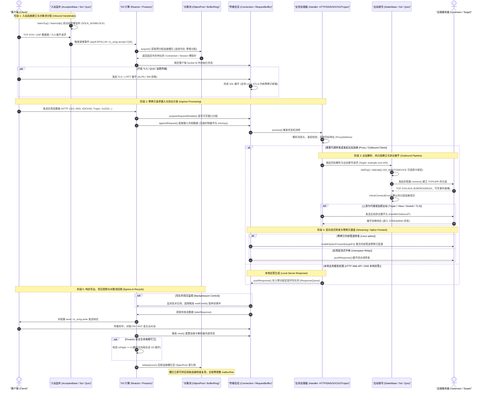

# mynet

[**English**](README.md) | [**中文简体**](README_zh.md)

[](https://en.cppreference.com/w/cpp/26)
[](https://kernel.org/)
[](#系统架构)
[](LICENSE)

`mynet` 是专为 Linux 平台打造的超高性能现代 C++26 异步网络框架与协议工具库。项目从底层设计出发，追求微秒级低延迟、热路径零分配（Zero-Allocation）以及严谨的现代 C++ 工程规范。`mynet` 提供了双 I/O 驱动引擎（基于边缘触发 `epoll` 的 **Reactor** 引擎与基于 `io_uring` 内核缓冲环的 **Proactor** 引擎）、统一的流与数据报传输抽象（TCP、TLS、UDP）、HTTP/2 线网兼容的多路复用处理器（HandlerHttp2）以及强类型无魔数的错误处理机制。

---

## 目录

- [核心特性](#核心特性)
- [系统架构](#系统架构)
- [核心设计与组件剖析](#核心设计与组件剖析)
  - [双 I/O 引擎：Reactor vs Proactor](#1-双-io-引擎reactor-vs-proactor)
  - [统一连接抽象与会话生命周期](#2-统一连接抽象与会话生命周期)
  - [热路径零堆分配内存架构](#3-热路径零堆分配内存架构)
  - [HTTP/2 帧编解码与流多路复用](#4-http2-帧编解码与流多路复用)
  - [UDP 数据报传输系统](#5-udp-数据报传输系统)
  - [现代 C++26 语言规范与强类型错误语义](#6-现代-c26-语言规范与强类型错误语义)
  - [配置归属](#7-配置归属引擎侧不保留硬编码默认值)
- [性能基准测试](#性能基准测试)
- [系统依赖与前置要求](#系统依赖与前置要求)
- [构建与编译](#构建与编译)
- [快速上手指南](#快速上手指南)
  - [1. 基于 epoll 的 TCP Echo 服务端（Reactor）](#1-基于-epoll-的-tcp-echo-服务端reactor)
  - [2. 基于 io_uring 与内核缓冲环的 TCP 服务端（Proactor）](#2-基于-io_uring-与内核缓冲环的-tcp-服务端proactor)
  - [3. 帧多路复用流服务端（HandlerHttp2）](#3-帧多路复用流服务端handlerhttp2)
- [工程代码目录结构](#工程代码目录结构)
- [单元测试与质量保证](#单元测试与质量保证)
- [开源许可证](#开源许可证)

---

## 核心特性

- **现代 C++26 语言标准与演进**:
  - 全面应用 C++26 前置条件契约（Contracts，`-fcontracts`），在接口编译边界强制断言调用合法性。
  - 采用附带原因说明的删除函数声明 `= delete("reason")`（P2573R2），提供精确的编译诊断。
  - 广泛采用 Concepts & Constraints（概念与约束），杜绝不合规模板特化。
  - 全流程采用 `std::expected` 与 `std::optional` 错误回报机制，彻底消除魔数负整数返回值。
- **双高性能异步 I/O 引擎**:
  - **Reactor**: 边缘触发模式 `epoll`（`EPOLLET`），搭配 `eventfd` 跨线程无锁唤醒机制与惰性消除 $O(1)$ 优先定时器队列（`TimerQueue`）。
  - **Proactor**: 纯异步完成态 `io_uring` 驱动，支持多次并发接收（`io_uring_prep_recv_multishot`）、多次连接接收（`io_uring_prep_accept`）、内核注册缓冲环（`io_uring_setup_buf_ring`）以及 Poll 驱动的无损 TLS。
- **热路径零动态堆内存分配**:
  - 地址稳定的固定容量对象池 `ObjectPool<T>`，内部使用连续槽位数组 `std::unique_ptr<Slot[]>` 与索引栈，彻底避免内存扩容重分配造成的指针失效与抖动。
  - 滑动窗口自收缩字节缓冲区 `RequestBuffer`，针对长连接读取优化，有效平摊与消除内存重新分配。
- **统一连接抽象与极端零拷贝传输**:
  - 声明 `kEnableSplice = true` 的处理器在明文 TCP 下自动启用 Linux `splice(2)` 内核零拷贝环回通道（`socket -> pipe -> socket`），达成 0 用户态内存拷贝与 0 内核内存拷贝（开启方式见 `examples/common/handlers.hpp` 的 `SpliceEchoHandler`）。
  - 用户态直写摄入架构（Direct Writable Ingress）：传输层通过 `prepareRequestWritable` 直接向 `RequestBuffer` 底层内存发起 `recv()`，彻底消除临时栈缓冲与中间 `memcpy`。
  - 向量化批量发送：明文连接支持通过 `writev(2)` 单次系统调用原子合并聚合冲刷至多 16 个响应切片，大幅降低系统调用开销。
- **透明统一的安全传输层**:
  - 一等公民级 OpenSSL 3.x 集成，明文 TCP 与加密 TLS 复用同一套数据收发主干逻辑。
  - 原生支持 ALPN 协议协商、SNI 域名匹配、异步握手流控制与平滑双向 TLS 关闭（`SSL_shutdown`）。
- **线网级协议解析与多路复用**:
  - HTTP/2 线网兼容的 9 字节标准帧编解码器（`Length:24`, `Type:8`, `Flags:8`, `StreamID:31`）。
  - RFC 7541 HPACK 首部压缩（静态表、动态表与 Huffman 解码）以及 RFC 9113 客户端连接前言校验，`curl --http2-prior-knowledge` 与 `nghttp` 可端到端互通。
  - 通用型流多路复用处理器 `HandlerHttp2<StreamHandler>`，实现单 TCP 连接承载多逻辑流，具备连接级与流级信用流控（`WINDOW_UPDATE`）、并发流数量上限控制与优雅 `GOAWAY` 下线。
  - 基于 `llhttp` 的 HTTP/1.x 编解码实现，支持请求流水线（Pipelining）与 Keep-Alive。
- **完备的系统可观测性与运维友好性**:
  - 强类型枚举错误码 `Err` 与 I/O 状态码 `IoEnd`。
  - 严格的输出通道隔离：业务数据通过 `stdout` 传输，结构化诊断日志通过 `mynet::log`（封装 `thirdparty/mylog`）输出至 `stderr`，防止管道重定向数据被污染。
  - **沙箱化 Lua 配置热重载与无锁代次快照**：支持 `mynet::reloadConfig("config/config.lua")`，在裸 `lua_State` 中执行（禁用 `os`/`io`/`package` 等库防命令执行），5000 万指令配额防死循环，支持数值边界安全钳位与全量事务级校验（All-or-Nothing）；配合 `ConfigHolder`/`ConfigSnapshot` 实现读路径零锁、零拷贝快照访问，并自动联合同步热重载 `mylog` 日志配置。

---

## 系统架构

`mynet` 采用统一非阻塞事件驱动与双传输对称架构，将服务端入站监听（`AcceptorBase`）、客户端出站建连（`DialerBase`）、双异步 I/O 驱动引擎（`Reactor` / `Proactor`）、传输会话（`Connection` / `DatagramContext`）以及全套业务协议处理器族（`src/handler/`）解耦闭环。

以下 Mermaid 详细时序图涵盖从入站连接接入、对象池零堆分配、用户态零拷贝数据直写、协议状态机解析、到出站 DNS 域名解析、四元组建连、出站协议握手（Trojan / VLESS / SOCKS5）、内核零拷贝 `splice` 管道转发、背压流控直到安全生命周期回收的全景流程：



---

## 核心设计与组件剖析

### 1. 双 I/O 引擎：Reactor vs Proactor

| 关键特性                 | Reactor 反应器模式 (`Reactor<Event>`)                    | Proactor 前摄器模式 (`Proactor<Event>`)                                        |
| :----------------------- | :--------------------------------------------------------- | :------------------------------------------------------------------------------- |
| **底层内核调用**   | Linux `epoll`（边缘触发，`EPOLLET`）                   | Linux `io_uring`                                                               |
| **I/O 事件机制**   | 就绪通知（Readiness Notification）                         | 异步完成通知（Completion Notification）                                          |
| **内存缓冲管理**   | 用户空间连接私有 `RequestBuffer`                         | 内核空间注册的缓冲环（`io_uring_buf_ring`）                                    |
| **系统调用开销**   | 每次事件循环触发 `epoll_wait` + 非阻塞 `recv`/`send` | 批量收割 CQE 完成事件，`multishot` 实现零系统调用连续接收                      |
| **TLS 结合方案**   | 直接调用 OpenSSL 非阻塞 `SSL_read`/`SSL_write`         | 通过 `io_uring_prep_poll_add` 监听就绪掩码驱动 OpenSSL，防止密文被内核提早劫持 |
| **跨线程任务投递** | `eventfd` 唤醒 + 循环所属任务队列（`runInLoop`）       | `std::stop_source` 信号与环队列批量投递                                        |

### 2. 统一连接抽象与会话生命周期

`Connection<HandlerType>` 统一了套接字描述符、TLS 加密状态、协议处理器与待发送队列：

- **传输对称性**：纯文本 TCP 与 TLS 加密会话复用同一套发送与接收骨干（`doRecv` 与 `doSend`）。TLS 仅作为底层传输属性，对上层协议处理器完全透明。
- **流水线安全**：发送队列采用定容响应队列 `ResponseQueue`，每个响应完整保存在独立字符串中，入队与出队热路径彻底杜绝动态堆分配，支持 HTTP/1.1 Pipelining 在单次读取产生多个响应时不会互相破坏缓冲区。
- **背压控制（Backpressure）**：内置高水位标记监测，当发送积压超出限额时自动触发 `readCredit()` 暂停接收端读取，避免发送队列无序膨胀引发内存溢出。
- **Proactor 会话生命周期保护**：在 `Proactor` 引擎中，每个连接被封装于 `Session` 中并严格统计内核在途操作（`inFlight`）。只有在会话被标记为终止且所有在途读写全部完成后，会话才会被安全回收到对象池。
- **处理器分层**：`HandlerConnection`（`connection.hpp`）与 `HandlerDatagram`（`datagram.hpp`）是两个并列的处理器基类，彼此没有共同祖先：前者持有流式会话的请求缓冲、响应队列与读信用背压，后者持有无连接数据报的对端回复队列。协议处理器（`HandlerHttp`、`HandlerHttp2`、`HandlerHttp3`）继承对应基类；需要双传输的处理器（`HandlerHttp3`）同时继承两者，由于两个基类都不是虚基类，成员访问是直接偏移，不存在虚基类间接寻址与共享子对象记账。原公共根类的基础契约（`reset`、`onMessageComplete`、`onParseError`）分别落在两个基类上，并以传输无关的方式表达为 `HandlerConstraint` 概念（`constraints.hpp`）——接收器槽位只依赖这一份最小契约（对象池只需要其中的 `Resettable`）。两个引擎契约为各自的传输通道命名，含义就是「该通道真正会调用的必需方法集合」：`MandatoryMethodConnection`（`connection.hpp`）与 `MandatoryMethodDatagram`（`datagram.hpp`）。二者各自紧邻其基类定义，使 `std::derived_from` 始终看到完整类型；同时都要求派生并逐项校验引擎经处理器类型本身调用的签名。纯报文处理器只需派生 `HandlerDatagram`：引擎把非流式处理器映射到无状态的 `NoConnection` 槽位（`ConnectionSlot`），把纯流式处理器映射到 `NoDatagram` 槽位（`DatagramSlot`），两条路径都不会实例化对方的传输设施。

### 3. 热路径零堆分配内存架构

- **`ObjectPool<Object>`**：预先分配由连续槽位数组 `std::unique_ptr<Slot[]>` 与定容索引栈构成的池化结构。对象一旦分配，其在内存中的地址终生不变，确保注册在 epoll 凭证或 io_uring 完成事件上下文中的裸指针永不失效，彻底消除频繁创建与销毁连接导致的内存碎片与分配开销。
- **`RequestBuffer`**：纯自管连续堆内存块（`operator new[](std::nothrow)` 零异常语义），提供真实可写直接窗口（`writableBytes()`、`writableBegin()`、`commitWritten()`、`ensureWritable()`）与零拷贝读视图（`readableView()`）。仅当已消费的死数据前缀超过 4 KiB 且达到占用总量一半以上时，才会在 `retrieve()` 触发就地数据搬移压缩，兼具极致性能与安全内存边界。
- **`ResponseQueue`**：定容连续循环响应队列（`src/responseQueue.hpp`），提供 $O(1)$ 零堆分配入队/出队与严格有界内存开销。
- **`StreamTable<T>`**：定容开放寻址平坦哈希表（`src/handler/http/v2/streamTable.hpp`），采用线性探测、墓碑删除与墓碑原位复用算法，实现多路复用流 ID 到槽位的零运行时堆分配。

### 4. HTTP/2 帧编解码与流多路复用

- **标准线网帧格式**：`FrameDecoder` 与 `appendFrame` 原生兼容标准 9 字节 HTTP/2 帧头，涵盖 `DATA`、`HEADERS`、`PRIORITY`、`RST_STREAM`、`SETTINGS`、`PUSH_PROMISE`、`PING`、`GOAWAY`、`WINDOW_UPDATE`。
- **客户端连接前言**：在解码任何帧之前校验 RFC 9113 §3.4 的 24 字节前言（允许分片到达）；前言错误回 `GOAWAY(PROTOCOL_ERROR)`，而不是被误读成 5 MiB 的帧。
- **HPACK（`handler/http/v2/hpack.hpp`）**：RFC 7541 解码——静态表、带淘汰的动态表、表大小更新与 Huffman 字符串——以及供 `sendResponse` 使用的无状态编码器。压缩失步以 `COMPRESSION_ERROR` 关闭连接；首部列表超限只重置该流。
- **分片首部块**：未带 `END_HEADERS` 的 `HEADERS` 由同流 `CONTINUATION` 帧重组（分片边界可以落在 HPACK 字段中间）。按 RFC 9113 §6.2，期间插入任何其他帧（包括其他流的帧）都以连接错误终止——这同时是 CVE-2024-27983 的防线；零长 `CONTINUATION` 洪水受 32 个空帧上限约束（总片数上限 4096），解码后超过宣告上限的首部列表回 `RST_STREAM`——该块仍会先被完整 HPACK 解码，连接的动态表绝不因此失步。
- **首部列表上限**：`sendSettings` 宣告的 `SETTINGS_MAX_HEADER_LIST_SIZE` 与解码器实际执行的上限取同一值，合规对端不会在中途触发上限。对端宣告的上限用于出站约束：`sendResponse` 拒绝对端已声明不接受的首部列表，出站 `HEADERS` 按对端 `SETTINGS_MAX_FRAME_SIZE` 拆成 `CONTINUATION`。
- **`HandlerHttp2<StreamHandler>`**：在单一字节流上承载多条独立请求/响应流。
  - `onStreamHeadersDecoded` 交付解码后的伪首部；`onStreamEnd` 在请求体完整到达时触发。
  - `sendResponse(streamId, status, body, extra)` 编码 `:status` 并沿既有流控路径发送响应。
- **`HandlerHttp2<StreamHandler>`**：
  - 实现单条物理传输流上承载海量并发逻辑流（Stream）。
  - 流表采用高性能定容开放寻址流表 `mux::StreamTable<StreamSlot>`，热路径无动态堆分配。
  - 内置连接级与各逻辑流级别的信用窗口流控机制。当可用窗口低于设定阈值时，自动向对端发送 `WINDOW_UPDATE`。
  - 通过 `SETTINGS_MAX_CONCURRENT_STREAMS` 控制并发连接上限，超出容量的并发流自动以 `RST_STREAM` 快速拒绝，保护服务端资源。
  - 每条独立流的协议处理状态直接从轻量 `ObjectPool<StreamHandler>` 获取。

### 5. UDP 数据报传输系统

- **`HandlerDatagram`**：针对 UDP 协议无连接、多对端报文交织的特点，提供专有的报文接收抽象。在收发报文中原样保留发送方地址信息（`sockaddr_in`），构筑 `DatagramReply` 队列。它是协议侧根类，只决定「回什么」。
- **`Datagram<Handler>`**：UDP 路径上 `Connection<Handler>` 的传输侧对等物（`datagram.hpp`）。它把一个处理器绑定到一条套接字，持有定容接收窗口与收发计数；超界截断与回复排空都在这里完成，两个引擎因此退化为事件分发（recvfrom 写入 `recvBuffer()`，交给 `receiveFrom()`，再用 `flushTo()` 排空）。它刻意不持有 fd、对端地址与写队列——UDP 无连接，这些属于逐报文状态而非逐会话状态。收发计数是给单元测试用的诊断设施而非生产指标：`runUdp` 返回前会 `reset()` 清零，引擎也没有暴露该会话对象的访问器，因此运行中的服务读不到这些值。`DatagramSlot<H>` 在编译期选择 `Datagram<H>` 或空壳 `NoDatagram`，与流式一侧的 `ConnectionSlot` 互为镜像。
- **过载丢包防护**：回复队列由 `maxPendingReplies` 限定容量，队列满时主动丢弃溢出数据报并递增丢包计数器，防止网络波动造成无界内存增长。

### 6. 现代 C++26 语言规范与强类型错误语义

- **杜绝任何魔数返回值**：
  - `enum class ERR : uint8_t`：覆盖全库所有内核与底层库的失败场景（如 `SOCKET_FAILED`、`SSL_CERT_FAILED`、`URING_BUF_RING_FAILED` 等），通过 `Result<T = void>` (`std::expected<T, ERR>`) 统一向上返回。
  - `enum class IO_END : uint8_t`：明确表达非错误性质的非阻塞 I/O 终结原因（`WOULDBLOCK` 需重试、`INTERRUPTED` 信号打断、`EOF_REACHED` 正常流结束、`FATAL` 致命错误），通过 `std::expected<size_t, IO_END>` 向上交付。
- **契约式编程（Contracts）**：通过 `contract_assert` 在入口处声明不变量与前置条件（如指针非空、端口在有效 16 位区间等）。

### 7. 配置归属：引擎侧不保留硬编码默认值

所有决定服务端引擎**分配多少**、内核队列**排多深**的可调参数，只有一个归属地：`configHolder.hpp` 提供编译期内建基线，`config/config.lua` 经 `reloadConfig()` 解析并钳位。`Reactor` 与 `Proactor` 自身不携带默认实参——两参数调用读取当前 `NetConfig` 快照：

```cpp
// 没有任何代码会自动加载 config.lua：新进程一开始用的就是 configHolder.hpp 的基线。
// 想应用 config/config.lua，必须在启动时显式调用一次。
mynet::reloadConfig("config/config.lua");

// 完全取自配置：监听地址来自 server.host / server.port
server.runTcp();

// 显式指定端点，配置仍取自快照
server.runTcp("0.0.0.0", 8888);

// 全部显式传入；校验契约相同
ReactorConfig reactorCfg = mynet::getReactorConfig();
reactorCfg.maxEvents = 2048;
server.runTcp("0.0.0.0", 8888, mynet::getServerConfig(), reactorCfg);

// TLS：runSsl() 从 security 段取 certFile / keyFile，未配置时拒绝启动；
// runSsl(crt, key) 则沿用配置里的监听地址。
tlsServer.runSsl();
```

不调用 `reloadConfig()` 也能跑，用的是编译期内建基线——它与随仓库提供的 `config.lua` 数值完全一致（有测试逐字段守着）。读者**不应**假定的是：只改 `config.lua` 就能改变一个正在运行的服务器。

每个字段还声明了**何时生效**，而且这个声明是数据而非文档：`configHolder.hpp` 里的 `kConfigReloadMap` 把每个点分路径映射到一个 `ReloadMode`，并由一条测试用静态反射枚举 `NetConfig` 全部字段，证明没有遗漏。

- **`Hot`（热）**——`reloadConfig()` 后立即生效。读取点在每连接或每次 I/O 的路径上（`Connection`、`Datagram`、`HandlerHttp2`），新连接与在途 I/O 立刻看到新值。
- **`Startup`（启动）**——只在 `listen()` / `serve()` / `runSsl()` 里读一次。`reloadConfig()` 会更新快照，但已在运行的引擎仍用启动时的值；要生效需重启该服务。

| 配置段 | 字段 | 生效时机 |
| :----- | :--- | :------- |
| `server` | `host`、`port`、`backlog`、`maxConnections`、`idleTimeoutSecs` | 启动 |
| `server` | `tcpNoDelay`、`tcpQuickAck`、`enableSplice` | 热 |
| `reactor` | `maxEvents`、`idleSweepIntervalMs` | 启动 |
| `proactor` | `sqEntries`、`cqEntries`、`maxAcceptEvents`、`bufEntries`、`bufSize`、`udpBufSize`、`bufRingAlignment`、`cqeWaitMs` | 启动 |
| `connection` | `responseCapacity`、`readChunkSize`、`maxRequestBytes`、`writeHighWaterMark`、`writeHardCapFactor`、`spliceChunkSize`、`maxWriteIov` | 热 |
| `datagram` | `maxDatagramBytes`、`maxPendingOutgoing` | 热 |
| `http2` | `maxConcurrentStreams`、`initialWindowSize`、`maxFrameSize` | 热 |
| `security` | `certFile`、`keyFile`、`caFile`、`ciphers`、`alpnProtocols` | 启动 |

`server.maxConnections` 是容量的唯一真源：Reactor 用它做连接池槽位数，Proactor 用它做会话池槽位数。`server.host`/`port` 由无参的 `runTcp()` / `runSsl()` 消费，`security.certFile`/`keyFile` 由不带路径参数的 `runSsl()` 消费——那个重载在路径未配置时会直接拒绝启动，而不是悄悄降级成明文。

把两个真相源合并成一个，必然要选定其中一个数值。因此有两处默认值发生了变化，这里明确写出，而不是留给运维者上线后意外发现：

- **监听 backlog `511` → `128`**：`runTcp`/`runSsl` 原本默认 `511`，而 `config.lua` 早已文档化为 `128`。以文档化值为准。
- **Proactor `sqEntries` `512` → `2048`，且 `cqEntries` 独立成项、默认 `2048`**：引擎原本默认 `sq=512`/`cq=1024`，而 `config.lua` 文档化为 `sq=2048`。以文档化值为准，同时把 `cq` 从"固定 2×sq"变成可配置项。
- **池容量统一到 `server.maxConnections`**：`reactor.connectionPoolSize` 与 `proactor.sessionPoolSize` 本是同一概念的两个名字，已删除。默认值 `8192`，对应的旧值是 Reactor 池 `1024`、Proactor 会话池 `512`。这是**预分配**的槽位数，不是可增长的上限：实测每槽约 3 KiB，因此 `8192` 启动即占约 24–26 MiB RSS，`65536` 约 190 MiB。（明文回显与 HTTP/2 两种处理器都实测过；HTTP/2 的流池按需分配，高并发多路复用在此外额外增长。）`config.lua` 原先写的 `65536` 从未被分配过（那是个只写不读的字段），所以没有沿用为默认值。

公开的引擎签名也变了，直接调用它们的代码需要注意：`Reactor::serve(size_t,int,int)` → `serve(const ServerConfig&, const ReactorConfig&)`、`Reactor::serveDatagram(int)` → `serveDatagram(const ReactorConfig&)`、`Proactor::serve(...)` → `serve(const ServerConfig&, const ProactorConfig&, bool)`，以及 `Event::listenTcp` 去掉了 `backlog = 511` 默认实参。仓库内调用点已全部更新；下游代码会在编译期失败，而不是悄悄改变行为。

另有四个别名被直接删除，它们的作用只是给另一个字段喂一份副本：`server.keepAliveTimeout_ms`（由 `server.idleTimeoutSecs` 取代）、`server.writeHighWaterMark` / `server.maxRequestBytes`（真正的消费者是 `connection` 段）、`security.enableTls`（调 `runSsl` 还是 `runTcp` 是编译期选择）、`multiplexer.maxHeaderListSize`（背后没有任何实现）。没有丢掉任何曾经生效的行为。被删的每个字段，要么从未被读取，要么只被用来填充另一个同样没有消费者的字段（`server.writeHighWaterMark` / `server.maxRequestBytes` 由解析器拷进 `connection` 段，而引擎真正读的是 `connection` 段）——一条指向虚无的别名链。

ALPN 需要单独说明：它**默认不启用**。`security.alpnProtocols = ""` 表示 `runSsl` 不安装 ALPN 选择回调，与本次重构之前的行为完全一致。只有当处理器确实实现了所宣告的协议时才应填写——一个回声服务器宣告 `h2` 等于对客户端撒谎。

密码套件遵循同一条"没让你改就别改"的原则。`security.ciphers` 为空（默认值）以及字面量 `"DEFAULT"`，都会被归一为**不调用** `SSL_CTX_set_cipher_list`。这不只是抠字眼：显式设置 `"DEFAULT"` 会覆盖 libssl 从 `openssl.cnf` 读到的 `system_default` 套件串，把加固策略悄悄顶掉；留空则让那套策略继续生效。

有两条性质由机制保证，而非依赖约定。`validReactorConfig()` / `validProactorConfig()` 是 `constexpr` 谓词，在每个引擎入口以及两个 `publish*Config()` 发布入口以契约断言校验，非法配置在调用点即中止，而不会延后表现为莫名的 `EPOLL`/`EINVAL` 错误。另一条是 `proactor.cqEntries < proactor.sqEntries`——内核在 `IORING_SETUP_CQSIZE` 下会以 `-EINVAL` 拒绝——解析期直接抬升到 `sqEntries`：两个各自合法的数字，不允许组合出一个起不来的引擎。

---

## 性能基准测试

以下基准测试在 Linux 环境中运行（x86_64，GCC 15，`-O2` 优化，单进程，日志流向与被测通道完全隔离）：

```text
基准测试项 (Benchmark)                        单操作耗时 (ns/op)   数据吞吐量 (Throughput)
--------------------------------------------------------------------------------------
RequestBuffer::append+reset (1KiB)                 12.7 ns/op         80,477.0 MB/s
RequestBuffer::append (16B) to 1KiB + drain               2.5 ns/op                  --
RequestBuffer::append+retrieve (16B)                      4.0 ns/op          4,041.9 MB/s
appendFrame (负载 16B)                             4.5 ns/op          3,555.4 MB/s
appendFrame (负载 1024B)                          12.3 ns/op         83,077.8 MB/s
appendFrame (负载 16384B)                        223.4 ns/op         73,328.8 MB/s
FrameDecoder::next (负载 16B)                     12.6 ns/op          1,268.1 MB/s
FrameDecoder::next (负载 1024B)                   77.5 ns/op         13,216.9 MB/s
FrameDecoder::next (负载 16384B)                1104.7 ns/op         14,831.4 MB/s
read+appendBigEndian32 (网络序处理)                0.7 ns/op                  --
ObjectPool acquire+release (128个对象)             3.8 ns/op                  --
HandlerConnection::pushResponse+takeResponse (1KiB)     22.5 ns/op         45,605.2 MB/s
HandlerConnection::process echo (1KiB 回显)             47.1 ns/op         21,760.2 MB/s
HandlerHttp2 open+echo+close (64条流)                   553.4 ns/op                  --
```

---

## 系统依赖与前置要求

- **操作系统**：Linux（推荐内核版本 >= 5.19 以支持完整的 `io_uring` 缓冲环机制）。
- **C++ 编译器**：GCC 14+ 或 GCC 15+（需支持 C++26 以及 `-fcontracts` 契约编译选项）。
- **构建工具**：CMake >= 3.25。
- **系统开发库**：
  - `liburing-dev` (>= 2.2)
  - `libssl-dev` (OpenSSL 3.x)
  - `libgtest-dev` (Google Test 单元测试框架)
  - `pkg-config`
  - `llhttp`

在 Arch Linux 环境下安装必要依赖：

```bash
sudo pacman -Syu --needed base-devel gcc cmake ninja pkgconf git openssl liburing llhttp luajit gtest
```

在 Ubuntu 25.10+ / Debian 环境下安装必要依赖：

```bash
sudo apt-get update
sudo apt-get install -y g++ cmake make ninja-build pkg-config libssl-dev liburing-dev libllhttp-dev libluajit-5.1-dev libgtest-dev
```

---

## 构建与编译

### 1. 克隆源码仓库（包含子模块）

```bash
git clone --recurse-submodules https://github.com/printf033/mynet.git
cd mynet
```

如果此前克隆时未添加子模块：

```bash
git submodule update --init --recursive
```

### 2. 使用 CMake 配置与构建

```bash
mkdir -p build && cd build
cmake -DCMAKE_BUILD_TYPE=Release ..
make -j$(nproc)
```

### 3. CMake 编译开关说明

| 选项名                | 默认值    | 作用说明                                                   |
| :-------------------- | :-------- | :--------------------------------------------------------- |
| `CMAKE_BUILD_TYPE`  | `Debug` | 编译构建类型（`Debug`, `Release`, `RelWithDebInfo`） |
| `BUILD_TESTING`     | `ON`    | 是否构建 Google Test 单元测试套件                          |
| `MYNET_BUILD_BENCH` | `ON`    | 是否构建核心性能微基准测试程序（`bench/bench`）          |

### 4. Docker 容器化运行

根目录附带基于最新滚动发行版 Arch Linux（`archlinux:latest`）的多阶段 `Dockerfile`：

```bash
docker build -t mynet:latest .
docker run --rm -it -p 8888:8888 mynet:latest
```

---

## 快速上手指南

### 1. 基于 epoll 的 TCP Echo 服务端（Reactor）

```cpp
#include "connection.hpp"
#include "error.hpp"
#include "log_config.hpp"
#include "reactor.hpp"

using namespace mynet;

int main() {
    mynet::log::init(); // 初始化日志并重定向至 stderr

    // 创建普通 TCP 套接字与 Echo 回显处理器的 Reactor 实例
    Reactor<AcceptorBase<HandlerConnection>> server;

    if (auto res = server.runTcp("0.0.0.0", 8888); !res) {
        LOG_ERROR("服务端启动失败: {}", toString(res.error()));
        return toExitCode(res.error());
    }
    return 0;
}
```

### 2. 基于 io_uring 与内核缓冲环的 TCP 服务端（Proactor）

```cpp
#include "connection.hpp"
#include "error.hpp"
#include "log_config.hpp"
#include "proactor.hpp"

using namespace mynet;

int main() {
    mynet::log::init();

    // 创建基于 io_uring 的 Proactor 前摄器服务端
    Proactor<AcceptorBase<HandlerConnection>> server;

    // 调优参数统一放在 config.lua 的 server / proactor 段，经 ConfigHolder 发布；
    // 引擎自身不再保留硬编码默认值。
    if (auto res = server.runTcp("0.0.0.0", 8888); !res) {
        LOG_ERROR("Proactor 启动失败: {}", toString(res.error()));
        return toExitCode(res.error());
    }
    return 0;
}
```

### 3. 帧多路复用流服务端（HandlerHttp2）

```cpp
#include "connection.hpp"
#include "error.hpp"
#include "handler/http/v2/handler.hpp"
#include "reactor.hpp"

using namespace mynet;

int main() {
    mynet::log::init();

    // 组合调用栈：Reactor -> Socket -> HandlerHttp2 (HTTP/2 协议帧多路复用) -> 每条流的处理器
    Reactor<AcceptorBase<HandlerHttp2<HandlerConnection>>> server;

    if (auto res = server.runTcp("0.0.0.0", 8888); !res) {
        LOG_ERROR("HTTP/2 服务端启动失败: {}", toString(res.error()));
        return toExitCode(res.error());
    }
    return 0;
}
```

全部示例都接受单个 `<host>:<port>` 参数，省略时使用各自的默认端点：

```bash
# 服务端：端点可任意指定（默认 0.0.0.0:8888，HTTP/3 为 4433）
./build/reactor_http1 127.0.0.1:9000
curl -X POST --data-binary 'hello' http://127.0.0.1:9000/
```

完整矩阵为：服务端 `{reactor,proactor}_{tcp,ssl,udp,http1,http2,http3}`。

---

## 工程代码目录结构

```text
mynet/
├── CMakeLists.txt              # CMake 顶级配置工程（声明 C++26 标准与 -fcontracts）
├── Dockerfile                  # 容器化镜像构建脚本
├── LICENSE                     # MIT 开源授权文件
├── README.md                   # 英文说明文档
├── README_zh.md                # 中文说明文档
│
├── src/                        # 核心头文件库实现
│   ├── CMakeLists.txt          # 纯头文件 Interface 接口库定义（INTERFACE mynet 与 mynet_lua）
│   ├── acceptor.hpp            # 服务端入站监听基础设施 (AcceptorBase / AcceptorSsl / AcceptorQuic)
│   ├── dialer.hpp              # 客户端出站建连基础设施 (DialerBase / DialerSsl / DialerQuic)
│   ├── connection.hpp          # TCP/TLS 传输层核心 + 连接处理器基类 (HandlerConnection)
│   ├── datagram.hpp            # UDP 传输层 Datagram<H> + 报文处理器基类 (HandlerDatagram)
│   ├── reactor.hpp             # 边缘触发模式 Reactor 反应器引擎核心
│   ├── proactor.hpp            # 基于 io_uring 完成态的 Proactor 前摄器引擎核心
│   ├── loop.hpp                # epoll EventLoop 事件循环与 eventfd 跨线程唤醒
│   ├── timer.hpp               # 惰性删除的高效二叉最小堆定时器队列
│   ├── tls.hpp                 # OpenSSL / KTLS 零拷贝内核卸载与多 SNI 握手支持
│   ├── requestBuffer.hpp       # 滑动窗口自收缩低开销请求双端缓冲区
│   ├── responseQueue.hpp       # 零分配定容循环响应队列
│   ├── objectPool.hpp          # 地址稳定的固定容量对象池
│   ├── constraints.hpp         # 通用约束（Resettable / HandlerConstraint / MandatoryMethod*）
│   ├── error.hpp               # 强类型错误码枚举 Err、IoEnd 与 errno/OpenSSL 错误文本
│   ├── configHolder.hpp        # 统一网络配置结构体与代次快照（NetConfig / ConfigHolder / ConfigSnapshot）
│   ├── lua_config.hpp          # 沙箱化 Lua 配置加载与热重载（reloadConfig）
│   ├── log_config.hpp          # 日志输出配置（mylog 输出至 stderr）
│   └── handler/                # 业务与协议处理器百宝箱 (All Handlers)
│       ├── handler.hpp         # 全量 Handler 便捷聚合头文件
│       ├── address.hpp         # 代理与网络目标端点地址抽象 (ProxyAddress)
│       ├── outbound.hpp        # 统一客户端出站协议族 (HandlerOutboundDirect / Trojan / Vless / Socks5 / Block)
│       ├── crypto.hpp          # 加密与哈希原语 (SHA-224, MD5, AEAD, UUID)
│       ├── direct.hpp / block.hpp # 直连路由与黑洞阻断处理器
│       ├── dns/                # RFC 1035 / RFC 3596 DNS 协议编解码与处理器
│       │   ├── dns.hpp         # 二进制报文序列化、反序列化、指针压缩 (0xC0xx)
│       │   └── handler.hpp     # HandlerDns (TCP) / HandlerDatagramDns (UDP) / HandlerOutboundDns
│       ├── http/               # HTTP 协议族实现
│       │   ├── v1/handler.hpp  # 基于 llhttp 的 HTTP/1.x 协议处理器 (HandlerHttp)
│       │   ├── v2/             # HTTP/2 分帧、HPACK 静态/动态表、流表与信用控制
│       │   ├── v3/             # HTTP/3 QUIC 1-RTT 短首部、QPACK、变长整数与流表
│       │   └── http.hpp        # HTTP Proxy 隧道代理处理器 (HandlerHttpProxy)
│       ├── socks/              # SOCKS 协议族 (SOCKS4 / SOCKS4a / RFC 1928 SOCKS5 / RFC 1929 认证)
│       ├── trojan/             # Trojan 协议出入站鉴权与隧道转发
│       ├── vless/              # VLESS 协议 UUID 鉴权与零拷贝透传
│       ├── vmess/              # VMess 协议 HMAC-MD5 头部鉴权
│       ├── hysteria2/          # Hysteria 2 协议认证握手与转发
│       ├── tuic/               # TUIC v5 协议处理
│       ├── shadowsocks/        # Shadowsocks AEAD 处理器 (SIP002)
│       ├── shadowtls/          # ShadowTLS SNI 嗅探与 HMAC 挑战分流
│       ├── snell/              # Snell v1~v4 协议处理
│       ├── transparent/        # Linux Netfilter TProxy / Redirect 原始目的地址透明代理
│       └── mixed/              # SOCKS4 / SOCKS5 / HTTP 自动嗅探自适应混合入站
│
├── config/                     # 运行时配置
│   └── config.lua              # 含完整中文注释的沙箱化 Lua 配置样例（全部分节）
│
├── examples/                   # 示例程序与可执行文件
│   ├── common/
│   │   ├── endpoint.hpp        # 全部示例共用的 "<host>:<port>" 解析
│   │   ├── handlers.hpp        # 两个引擎共用的 SpliceEchoHandler / UdpEchoHandler
│   │   ├── http2.hpp           # HTTP/2 示例辅助处理器
│   │   └── resolver.hpp        # DNS 缓存与快速解析策略示例 (DnsResolver)
│   ├── reactor/                # epoll 边沿触发 Reactor 服务端
│   │   ├── tcp.cpp             # reactor_tcp     TCP 回显（splice 零拷贝）
│   │   ├── ssl.cpp             # reactor_ssl     TLS 回显
│   │   ├── udp.cpp             # reactor_udp     UDP 数据报回显
│   │   ├── http1.cpp           # reactor_http1   基于 llhttp 的 HTTP/1.x
│   │   ├── http2.cpp           # reactor_http2   HTTP/2 流多路复用
│   │   ├── http3.cpp           # reactor_http3   HTTP/3（QUIC/UDP）
│   │   ├── socks5.cpp          # reactor_socks5  SOCKS5 代理服务端
│   │   └── proxy.cpp           # reactor_proxy   多协议自适应混合代理
│   └── proactor/               # io_uring 完成事件 Proactor 服务端
│       ├── tcp.cpp             # proactor_tcp    TCP 回显（multishot accept + 缓冲环）
│       ├── ssl.cpp             # proactor_ssl    TLS 回显（Poll 驱动握手）
│       ├── udp.cpp             # proactor_udp    UDP 数据报回显
│       ├── http1.cpp           # proactor_http1  基于 llhttp 的 HTTP/1.x
│       ├── http2.cpp           # proactor_http2  HTTP/2 流多路复用
│       ├── http3.cpp           # proactor_http3  HTTP/3（QUIC/UDP）
│       ├── socks5.cpp          # proactor_socks5 SOCKS5 代理服务端
│       └── proxy.cpp           # proactor_proxy  多协议自适应混合代理
│
├── tests/                      # 单元测试工程（Google Test + ASan 内存安全检查）
│   ├── test_request_buffer.cpp # 缓冲区边界与压缩测试
│   ├── test_constraints.cpp    # 约束概念、可重置性与 Dialer/Acceptor 概念评估测试
│   ├── test_datagram.cpp       # UDP 传输会话的窗口定容、截断与排空测试
│   ├── test_error.cpp          # 错误码一致性测试
│   ├── test_frame.cpp          # 协议帧拆装包测试
│   ├── test_handler.cpp        # 处理器状态流转测试
│   ├── test_hpack.cpp          # HPACK 静态/动态表与 Huffman 编解码测试
│   ├── test_http3.cpp          # HTTP/3 变长整数、分帧、QPACK 与 QUIC 报文测试
│   ├── test_http2.cpp          # HTTP/2 流多路复用状态机与流控测试
│   ├── test_object_pool.cpp    # 对象池生命周期与指针稳定性测试
│   ├── test_timer.cpp          # 定时器精度与取消测试
│   ├── test_tls.cpp            # TLS 握手与 ALPN 协商测试
│   ├── test_socks5.cpp         # SOCKS5 握手协议与认证测试
│   ├── test_proxy_protocols.cpp# 代理协议全族静态契约与边界测试
│   ├── test_dialer.cpp         # 客户端拨号建连、出站状态机与 DNS 处理器测试
│   ├── test_log_config.cpp     # 日志级别与输出配置测试
│   └── test_config_lua.cpp     # 沙箱化 Lua 配置热重载与边界钳位测试
│
├── bench/                      # 性能基准测试
│   ├── bench.cpp               # 核心模块纳秒级延时与吞吐测试
│   └── bench_network.cpp       # 网络高并发吞吐压测
│
├── certs/                      # 本地测试自签名 SSL/TLS 证书及私钥
├── scripts/                    # 辅助脚本（代码格式化等）
└── thirdparty/                 # 外部依赖子模块（mylog）
```

---

## 单元测试与质量保证

所有的单元测试均已启用 **AddressSanitizer (ASan)** 并开启最高级别告警选项（`-Wall -Wextra -Wpedantic`），保障代码在极端边界条件下的内存安全性：

```bash
cd build
ctest --output-on-failure
```

测试执行结果（17 套测试套件全部 100% 通过）：

```text
Test project /home/aaa/code/mynet/build
      Start  1: test_request_buffer
 1/17 Test  #1: test_request_buffer ..............   Passed    0.01 sec
      Start  2: test_constraints
 2/17 Test  #2: test_constraints .................   Passed    0.02 sec
      Start  3: test_datagram
 3/17 Test  #3: test_datagram ....................   Passed    0.02 sec
      Start  4: test_error
 4/17 Test  #4: test_error .......................   Passed    0.01 sec
      Start  5: test_frame
 5/17 Test  #5: test_frame .......................   Passed    0.01 sec
      Start  6: test_handler
 6/17 Test  #6: test_handler .....................   Passed    0.03 sec
      Start  7: test_hpack
 7/17 Test  #7: test_hpack .......................   Passed    0.02 sec
      Start  8: test_http3
 8/17 Test  #8: test_http3 .......................   Passed    0.03 sec
      Start  9: test_http2
 9/17 Test  #9: test_http2 .......................   Passed    0.17 sec
      Start 10: test_object_pool
10/17 Test #10: test_object_pool .................   Passed    0.02 sec
      Start 11: test_timer
11/17 Test #11: test_timer .......................   Passed    0.03 sec
      Start 12: test_tls
12/17 Test #12: test_tls .........................   Passed    0.03 sec
      Start 13: test_socks5
13/17 Test #13: test_socks5 ......................   Passed    0.01 sec
      Start 14: test_proxy_protocols
14/17 Test #14: test_proxy_protocols .............   Passed    0.02 sec
      Start 15: test_dialer
15/17 Test #15: test_dialer ......................   Passed    0.02 sec
      Start 16: test_log_config
16/17 Test #16: test_log_config ..................   Passed    0.01 sec
      Start 17: test_config_lua
17/17 Test #17: test_config_lua ..................   Passed    1.10 sec

100% tests passed, 0 tests failed out of 17
```

---

## 开源许可证

本项目基于 **MIT License** 开源。详细授权信息请参阅 [LICENSE](LICENSE) 文件。
