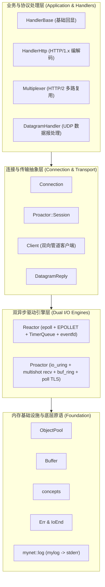

# mynet

[**English**](README.md) | [**中文简体**](README_zh.md)

[](https://en.cppreference.com/w/cpp/26)
[](https://kernel.org/)
[](#系统架构)
[](LICENSE)

`mynet` 是专为 Linux 平台打造的超高性能现代 C++26 异步网络框架与协议工具库。项目从底层设计出发，追求微秒级低延迟、热路径零分配（Zero-Allocation）以及严谨的现代 C++ 工程规范。`mynet` 提供了双 I/O 驱动引擎（基于边缘触发 `epoll` 的 **Reactor** 引擎与基于 `io_uring` 内核缓冲环的 **Proactor** 引擎）、统一的流与数据报传输抽象（TCP、TLS、UDP）、HTTP/2 线网兼容的多路复用器（Multiplexer）以及强类型无魔数的错误处理机制。

---

## 目录

- [核心特性](#核心特性)
- [系统架构](#系统架构)
- [核心设计与组件剖析](#核心设计与组件剖析)
  - [双 I/O 引擎：Reactor vs Proactor](#1-双-io-引擎reactor-vs-proactor)
  - [统一连接抽象与会话生命周期](#2-统一连接抽象与会话生命周期)
  - [热路径零堆分配内存架构](#3-热路径零堆分配内存架构)
  - [HTTP/2 帧编解码与流多路复用](#4-http2-帧编解码与流多路复用)
  - [UDP 数据报传输系统](#5-udp-数据报传输系统)
  - [现代 C++26 语言规范与强类型错误语义](#6-现代-c26-语言规范与强类型错误语义)
  - [管道式双向客户端（Client）](#7-管道式双向客户端client)
- [性能基准测试](#性能基准测试)
- [系统依赖与前置要求](#系统依赖与前置要求)
- [构建与编译](#构建与编译)
- [快速上手指南](#快速上手指南)
  - [1. 基于 epoll 的 TCP Echo 服务端（Reactor）](#1-基于-epoll-的-tcp-echo-服务端reactor)
  - [2. 基于 io_uring 与内核缓冲环的 TCP 服务端（Proactor）](#2-基于-io_uring-与内核缓冲环的-tcp-服务端proactor)
  - [3. 帧多路复用流服务端（Multiplexer）](#3-帧多路复用流服务端multiplexer)
  - [4. Unix 管道风格双向流客户端（Client）](#4-unix-管道风格双向流客户端client)
- [工程代码目录结构](#工程代码目录结构)
- [单元测试与质量保证](#单元测试与质量保证)
- [开源许可证](#开源许可证)

---

## 核心特性

- **现代 C++26 语言标准与演进**:
  - 全面应用 C++26 前置条件契约（Contracts，`-fcontracts`），在接口编译边界强制断言调用合法性。
  - 采用附带原因说明的删除函数声明 `= delete("reason")`（P2573R2），提供精确的编译诊断。
  - 广泛采用 Concepts & Constraints（概念与约束），杜绝不合规模板特化。
  - 全流程采用 `std::expected` 与 `std::optional` 错误回报机制，彻底消除魔数负整数返回值。
- **双高性能异步 I/O 引擎**:
  - **Reactor**: 边缘触发模式 `epoll`（`EPOLLET`），搭配 `eventfd` 跨线程无锁唤醒机制与惰性消除 $O(1)$ 优先定时器队列（`TimerQueue`）。
  - **Proactor**: 纯异步完成态 `io_uring` 驱动，支持多次并发接收（`io_uring_prep_recv_multishot`）、多次连接接收（`io_uring_prep_accept`）、内核注册缓冲环（`io_uring_setup_buf_ring`）以及 Poll 驱动的无损 TLS。
- **热路径零动态堆内存分配**:
  - 地址稳定的固定容量对象池 `ObjectPool<T>`，内部使用连续槽位数组 `std::unique_ptr<Slot[]>` 与索引栈，彻底避免内存扩容重分配造成的指针失效与抖动。
  - 滑动窗口自收缩字节缓冲区 `Buffer`，针对长连接读取优化，有效平摊与消除内存重新分配。
- **透明统一的安全传输层**:
  - 一等公民级 OpenSSL 3.x 集成，明文 TCP 与加密 TLS 复用同一套数据收发主干逻辑。
  - 原生支持 ALPN 协议协商、SNI 域名匹配、异步握手流控制与平滑双向 TLS 关闭（`SSL_shutdown`）。
- **线网级协议解析与多路复用**:
  - HTTP/2 线网兼容的 9 字节标准帧编解码器（`Length:24`, `Type:8`, `Flags:8`, `StreamID:31`）。
  - 通用型流多路复用器 `Multiplexer<StreamHandler>`，实现单 TCP 连接承载多逻辑流，具备连接级与流级信用流控（`WINDOW_UPDATE`）、并发流数量上限控制与优雅 `GOAWAY` 下线。
  - 基于 `llhttp` 的 HTTP/1.x 编解码实现，支持请求流水线（Pipelining）与 Keep-Alive。
- **完备的系统可观测性与运维友好性**:
  - 强类型枚举错误码 `Err` 与 I/O 状态码 `IoEnd`。
  - 严格的输出通道隔离：业务数据通过 `stdout` 传输，结构化诊断日志通过 `mynet::log`（封装 `third_party/mylog`）输出至 `stderr`，防止管道重定向数据被污染。

---

## 系统架构

`mynet` 采用高度模块化的分层解耦架构：



---

## 核心设计与组件剖析

### 1. 双 I/O 引擎：Reactor vs Proactor

| 关键特性                 | Reactor 反应器模式 (`Reactor<Event>`)                    | Proactor 前摄器模式 (`Proactor<Event>`)                                        |
| :----------------------- | :--------------------------------------------------------- | :------------------------------------------------------------------------------- |
| **底层内核调用**   | Linux `epoll`（边缘触发，`EPOLLET`）                   | Linux `io_uring`                                                               |
| **I/O 事件机制**   | 就绪通知（Readiness Notification）                         | 异步完成通知（Completion Notification）                                          |
| **内存缓冲管理**   | 用户空间连接私有 `Buffer`                                | 内核空间注册的缓冲环（`io_uring_buf_ring`）                                    |
| **系统调用开销**   | 每次事件循环触发 `epoll_wait` + 非阻塞 `recv`/`send` | 批量收割 CQE 完成事件，`multishot` 实现零系统调用连续接收                      |
| **TLS 结合方案**   | 直接调用 OpenSSL 非阻塞 `SSL_read`/`SSL_write`         | 通过 `io_uring_prep_poll_add` 监听就绪掩码驱动 OpenSSL，防止密文被内核提早劫持 |
| **跨线程任务投递** | `eventfd` 唤醒 + 循环所属任务队列（`runInLoop`）       | `std::stop_source` 信号与环队列批量投递                                        |

### 2. 统一连接抽象与会话生命周期

`Connection<HandlerType>` 统一了套接字描述符、TLS 加密状态、协议处理器与待发送队列：

- **传输对称性**：纯文本 TCP 与 TLS 加密会话复用同一套发送与接收骨干（`doRecv` 与 `doSend`）。TLS 仅作为底层传输属性，对上层协议处理器完全透明。
- **流水线安全**：发送队列采用 `std::deque<std::string>`，每个响应完整保存在独立字符串中，支持 HTTP/1.1 Pipelining 在单次读取产生多个响应时不会互相破坏缓冲区。
- **背压控制（Backpressure）**：内置高水位标记监测，当发送积压超出限额时自动触发 `readCredit()` 暂停接收端读取，避免发送队列无序膨胀引发内存溢出。
- **Proactor 会话生命周期保护**：在 `Proactor` 引擎中，每个连接被封装于 `Session` 中并严格统计内核在途操作（`inFlight`）。只有在会话被标记为终止且所有在途读写全部完成后，会话才会被安全回收到对象池。

### 3. 热路径零堆分配内存架构

- **`ObjectPool<Object>`**：预先分配由连续槽位数组 `std::unique_ptr<Slot[]>` 与空闲索引栈构成的池化结构。对象一旦分配，其在内存中的地址终生不变，确保注册在 epoll 凭证或 io_uring 完成事件上下文中的裸指针永不失效，彻底消除频繁创建与销毁连接导致的内存碎片与分配开销。
- **`Buffer`**：带独立读游标的连续字符串存储。只有当已消费的死数据前缀超过 4 KiB 且达到占用总量一半以上时，才会触发就地数据搬移压缩，有效平摊扩容与压缩成本。

### 4. HTTP/2 帧编解码与流多路复用

- **标准线网帧格式**：`FrameDecoder` 与 `appendFrame` 原生兼容标准 9 字节 HTTP/2 帧头，涵盖 `DATA`、`HEADERS`、`PRIORITY`、`RST_STREAM`、`SETTINGS`、`PUSH_PROMISE`、`PING`、`GOAWAY`、`WINDOW_UPDATE`。
- **`Multiplexer<StreamHandler>`**：
  - 实现单条物理传输流上承载海量并发逻辑流（Stream）。
  - 内置连接级与各逻辑流级别的信用窗口流控机制。当可用窗口低于设定阈值时，自动向对端发送 `WINDOW_UPDATE`。
  - 通过 `SETTINGS_MAX_CONCURRENT_STREAMS` 控制并发连接上限，超出容量的并发流自动以 `RST_STREAM` 快速拒绝，保护服务端资源。
  - 每条独立流的协议处理状态直接从轻量 `ObjectPool<StreamHandler>` 获取。

### 5. UDP 数据报传输系统

- **`DatagramHandler`**：针对 UDP 协议无连接、多对端报文交织的特点，提供专有的报文接收抽象。在收发报文中原样保留发送方地址信息（`sockaddr_in`），构筑 `DatagramReply` 队列。
- **过载丢包防护**：内置可配置的待发队列上限。当队列发生拥塞积压时，主动丢弃溢出数据报并递增丢包计数器，防止网络波动造成无界内存增长。

### 6. 现代 C++26 语言规范与强类型错误语义

- **杜绝任何魔数返回值**：
  - `enum class ERR : uint8_t`：覆盖全库所有内核与底层库的失败场景（如 `SOCKET_FAILED`、`SSL_CERT_FAILED`、`URING_BUF_RING_FAILED` 等），通过 `Result<T = void>` (`std::expected<T, ERR>`) 统一向上返回。
  - `enum class IO_END : uint8_t`：明确表达非错误性质的非阻塞 I/O 终结原因（`WOULDBLOCK` 需重试、`INTERRUPTED` 信号打断、`EOF_REACHED` 正常流结束、`FATAL` 致命错误），通过 `std::expected<size_t, IO_END>` 向上交付。
- **契约式编程（Contracts）**：通过 `contract_assert` 在入口处声明不变量与前置条件（如指针非空、端口在有效 16 位区间等）。

### 7. 管道式双向客户端（Client）

`Client<Event>` 遵循 Unix 哲学，作为独立高效的命令行数据泵将标准输入（stdin）与套接字全双工桥接至标准输出（stdout）：

```bash
cat payload.bin | ./client_tcp 127.0.0.1 8888 > output.bin
```

内置标准输入高低水位回压调节、平滑半关闭握手（TCP `FIN` 或 TLS `close_notify`）、`SIGPIPE` 信号阻断与还原，支持管道、终端与常规文件重定向。

---

## 性能基准测试

以下基准测试在 Linux 环境中运行（x86_64，GCC 15，`-O2` 优化，单进程，日志流向与被测通道完全隔离）：

```text
基准测试项 (Benchmark)                        单操作耗时 (ns/op)   数据吞吐量 (Throughput)
--------------------------------------------------------------------------------------
Buffer::append+retrieveAll (1KiB)                 11.0 ns/op         92,950.8 MB/s
Buffer::append (16B) to 1KiB + drain               3.0 ns/op                  --
Buffer::append+retrieve (16B)                      3.2 ns/op          5,059.1 MB/s
appendFrame (负载 16B)                             4.7 ns/op          3,430.8 MB/s
appendFrame (负载 1024B)                          12.7 ns/op         80,516.0 MB/s
appendFrame (负载 16384B)                        161.1 ns/op        101,672.5 MB/s
FrameDecoder::next (负载 16B)                     12.8 ns/op          1,249.5 MB/s
FrameDecoder::next (负载 1024B)                   82.3 ns/op         12,442.8 MB/s
FrameDecoder::next (负载 16384B)                1135.2 ns/op         14,433.3 MB/s
read+appendBigEndian32 (网络序处理)                0.6 ns/op                  --
ObjectPool acquire+release (128个对象)             6.9 ns/op                  --
HandlerBase::pushResponse+takeResponse (1KiB)     23.2 ns/op         44,127.1 MB/s
HandlerBase::process echo (1KiB 回显)             33.4 ns/op         30,664.0 MB/s
Multiplexer open+echo+close (64条流)             590.4 ns/op                  --
```

---

## 系统依赖与前置要求

- **操作系统**：Linux（推荐内核版本 >= 5.19 以支持完整的 `io_uring` 缓冲环机制）。
- **C++ 编译器**：GCC 14+ 或 GCC 15+（需支持 C++26 以及 `-fcontracts` 契约编译选项）。
- **构建工具**：CMake >= 3.25。
- **系统开发库**：
  - `liburing-dev` (>= 2.2)
  - `libssl-dev` (OpenSSL 3.x)
  - `libgtest-dev` (Google Test 单元测试框架)
  - `pkg-config`
  - `llhttp`

在 Ubuntu 25.10+ / Debian 环境下安装必要依赖：

```bash
sudo apt-get update
sudo apt-get install -y g++ cmake make pkg-config libssl-dev liburing-dev libgtest-dev libpq-dev
```

---

## 构建与编译

### 1. 克隆源码仓库（包含子模块）

```bash
git clone --recurse-submodules https://github.com/printf033/mynet.git
cd mynet
```

如果此前克隆时未添加子模块：

```bash
git submodule update --init --recursive
```

### 2. 使用 CMake 配置与构建

```bash
mkdir -p build && cd build
cmake -DCMAKE_BUILD_TYPE=Release ..
make -j$(nproc)
```

### 3. CMake 编译开关说明

| 选项名                | 默认值    | 作用说明                                                   |
| :-------------------- | :-------- | :--------------------------------------------------------- |
| `CMAKE_BUILD_TYPE`  | `Debug` | 编译构建类型（`Debug`, `Release`, `RelWithDebInfo`） |
| `BUILD_TESTING`     | `ON`    | 是否构建 Google Test 单元测试套件                          |
| `MYNET_BUILD_BENCH` | `ON`    | 是否构建核心性能微基准测试程序（`bench/bench_core`）     |

### 4. Docker 容器化运行

根目录附带基于 Ubuntu 25.10 的多阶段 `Dockerfile`：

```bash
docker build -t mynet:latest .
docker run --rm -it -p 8888:8888 mynet:latest
```

---

## 快速上手指南

### 1. 基于 epoll 的 TCP Echo 服务端（Reactor）

```cpp
#include "error.hpp"
#include "handler.hpp"
#include "log.hpp"
#include "reactor.hpp"

using namespace mynet;

int main() {
    mynet::log::init(); // 初始化日志并重定向至 stderr

    // 创建普通 TCP 套接字与 Echo 回显处理器的 Reactor 实例
    Reactor<EventSocket<HandlerBase>> server;

    if (auto res = server.runTcp("0.0.0.0", 8888); !res) {
        LOG_ERROR("服务端启动失败: {}", toString(res.error()));
        return toExitCode(res.error());
    }
    return 0;
}
```

### 2. 基于 io_uring 与内核缓冲环的 TCP 服务端（Proactor）

```cpp
#include "error.hpp"
#include "handler.hpp"
#include "log.hpp"
#include "proactor.hpp"

using namespace mynet;

int main() {
    mynet::log::init();

    // 创建基于 io_uring 的 Proactor 前摄器服务端
    Proactor<EventSocket<HandlerBase>> server;

    // 参数：IP, 端口, backlog, SQ队列长度, CQ队列长度, 最大并发Accept, 会话池大小, 缓冲环单元数, 单缓冲区大小
    if (auto res = server.runTcp("0.0.0.0", 8888, 511, 512, 1024, 256, 512, 1024, 4096); !res) {
        LOG_ERROR("Proactor 启动失败: {}", toString(res.error()));
        return toExitCode(res.error());
    }
    return 0;
}
```

### 3. 帧多路复用流服务端（Multiplexer）

```cpp
#include "error.hpp"
#include "handler.hpp"
#include "multiplexer.hpp"
#include "reactor.hpp"

using namespace mynet;

int main() {
    mynet::log::init();

    // 组合调用栈：Reactor -> Socket -> Multiplexer (HTTP/2 协议帧多路复用) -> Trace 调试回显
    Reactor<EventSocket<Multiplexer<HandlerBase>>> server;

    if (auto res = server.runTcp("0.0.0.0", 8888); !res) {
        LOG_ERROR("多路复用服务端启动失败: {}", toString(res.error()));
        return toExitCode(res.error());
    }
    return 0;
}
```

### 4. Unix 管道风格双向流客户端（Client）

```cpp
#include "error.hpp"
#include "handler.hpp"
#include "client.hpp"

using namespace mynet;

int main(int argc, char* argv[]) {
    mynet::log::init();
    Client<EventSocket<HandlerBase>> client;

    // 建立连接并将标准输入流入网络，将对端返回输出至标准输出
    if (auto res = client.runTcp("127.0.0.1", 8888); !res) {
        LOG_ERROR("Client 客户端发生错误: {}", toString(res.error()));
        return toExitCode(res.error());
    }
    return 0;
}
```

命令行快速测试：

```bash
# 发送 HTTP 请求并实时查看回包
printf "GET / HTTP/1.1\r\nHost: localhost\r\n\r\n" | ./build/client_tcp 127.0.0.1 8888
```

---

## 工程代码目录结构

```text
mynet/
├── CMakeLists.txt              # CMake 顶级配置工程（声明 C++26 标准与 -fcontracts）
├── Dockerfile                  # 容器化镜像构建脚本
├── LICENSE                     # MIT 开源授权文件
├── README.md                   # 英文说明文档
├── README_zh.md                # 中文说明文档
│
├── src/                        # 核心头文件库实现
│   ├── CMakeLists.txt          # 纯头文件 Interface 接口库定义（INTERFACE mynet）
│   ├── concepts.hpp            # C++20/C++26 Concept 概念定义与类型约束
│   ├── error.hpp               # 强类型错误码枚举 Err 与 I/O 状态 IoEnd
│   ├── log.hpp                 # 日志适配门面（封装 mylog 并路由至 stderr）
│   ├── buffer.hpp              # 滑动窗口自收缩低开销字节缓冲区
│   ├── objectPool.hpp          # 地址稳定的固定容量对象池
│   ├── timer.hpp               # 惰性删除的高效二叉最小堆定时器队列
│   ├── loop.hpp                # epoll EventLoop 事件循环与 eventfd 跨线程唤醒
│   ├── event.hpp               # 套接字及 SSL 监听通道抽象
│   ├── connection.hpp          # 统一的 TCP/TLS 传输层核心实现与响应缓冲队列
│   ├── datagram.hpp            # UDP 数据报传输层抽象
│   ├── handler.hpp             # 业务处理器抽象（HandlerBase 与 HandlerHttp）
│   ├── frame.hpp               # HTTP/2 兼容的标准协议帧编解码器
│   ├── multiplexer.hpp         # 基于信用的流多路复用调度器
│   ├── reactor.hpp             # 边缘触发模式 Reactor 反应器引擎
│   ├── proactor.hpp            # 基于 io_uring 完成态的 Proactor 前摄器引擎
│   └── client.hpp              # 管道式双向网络客户端（stdin/stdout 桥接）
│
├── samples/                    # 示例程序与可执行文件
│   ├── reactor_tcp.cpp         # 基于 Reactor 的 TCP 回显服务端
│   ├── reactor_ssl.cpp         # 基于 Reactor 的 TLS 安全服务端
│   ├── reactor_udp.cpp         # 基于 Reactor 的 UDP 回显服务端
│   ├── proactor_tcp.cpp        # 基于 Proactor 与内核缓冲环的 TCP 服务端
│   ├── proactor_ssl.cpp        # 基于 Proactor 的 TLS 安全服务端（Poll 驱动）
│   ├── proactor_udp.cpp        # 基于 Proactor 的 UDP 服务端
│   ├── multiplex_tcp.cpp       # 基于 Reactor 的流多路复用服务端
│   ├── proactor_multiplex.cpp  # 基于 Proactor 的流多路复用服务端
│   ├── client_tcp.cpp          # 命令行 TCP 流客户端
│   ├── client_ssl.cpp          # 命令行 TLS 安全客户端
│   └── client_udp.cpp          # 命令行 UDP 客户端
│
├── tests/                      # 单元测试工程（Google Test + ASan 内存安全检查）
│   ├── test_buffer.cpp         # 缓冲区边界与压缩测试
│   ├── test_concepts.cpp       # 概念约束与可重置性测试
│   ├── test_error.cpp          # 错误码一致性测试
│   ├── test_frame.cpp          # 协议帧拆装包测试
│   ├── test_handler.cpp        # 处理器状态流转测试
│   ├── test_multiplexer.cpp    # 流多路复用状态机与流控测试
│   ├── test_object_pool.cpp    # 对象池生命周期与指针稳定性测试
│   └── test_timer.cpp          # 定时器精度与取消测试
│
├── bench/                      # 性能基准测试
│   └── bench_core.cpp          # 核心模块纳秒级延时与吞吐测试
│
├── certs/                      # 本地测试自签名 SSL/TLS 证书及私钥
├── scripts/                    # 辅助脚本（代码格式化等）
└── third_party/                # 外部依赖子模块（mylog）
```

---

## 单元测试与质量保证

所有的单元测试均已启用 **AddressSanitizer (ASan)** 并开启最高级别告警选项（`-Wall -Wextra -Wpedantic`），保障代码在极端边界条件下的内存安全性：

```bash
cd build
ctest --output-on-failure
```

测试执行结果：

```text
Test project /home/aaa/code/mynet/build
    Start 1: test_buffer
1/8 Test #1: test_buffer ......................   Passed    0.01 sec
    Start 2: test_concepts
2/8 Test #2: test_concepts ....................   Passed    0.01 sec
    Start 3: test_error
3/8 Test #3: test_error .......................   Passed    0.01 sec
    Start 4: test_frame
4/8 Test #4: test_frame .......................   Passed    0.01 sec
    Start 5: test_handler
5/8 Test #5: test_handler .....................   Passed    0.01 sec
    Start 6: test_multiplexer
6/8 Test #6: test_multiplexer .................   Passed    0.02 sec
    Start 7: test_object_pool
7/8 Test #7: test_object_pool .................   Passed    0.01 sec
    Start 8: test_timer
8/8 Test #8: test_timer .......................   Passed    0.02 sec

100% tests passed out of 8
```

---

## 开源许可证

本项目基于 **MIT License** 开源。详细授权信息请参阅 [LICENSE](LICENSE) 文件。
