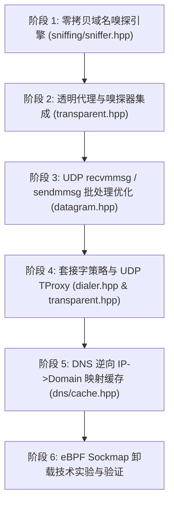

# 借鉴 dae 深度优化 mynet 架构分析与实施计划

本文档基于对高吞吐 Linux 透明代理内核 [`dae`](https://github.com/daeuniverse/dae)（位于 `/home/aaa/misc/dae`）的源码深度剖析，结合 `mynet` 项目现状（C++26 / `-fno-exceptions` / `-fcontracts` / Reactor & Proactor 架构），系统性梳理 `dae` 的核心设计哲学、性能加速技术，并输出详尽的 `mynet` 优化升级计划与落地实现规范。

---

## 目录

1. [项目背景与技术定位对比](#1-项目背景与技术定位对比)
2. [dae 核心技术深度解构](#2-dae-核心技术深度解构)
   * 2.1 [内核旁路与“真直连”（Real Direct via eBPF TC Hooks）](#21-内核旁路与真直连real-direct-via-ebpf-tc-hooks)
   * 2.2 [L7 零拷贝协议深度嗅探（Domain Sniffing Engine）](#22-l7-零拷贝协议深度嗅探domain-sniffing-engine)
   * 2.3 [UDP 高并发批处理机制（Batch I/O via recvmmsg / sendmmsg）](#23-udp-高并发批处理机制batch-io-via-recvmmsg--sendmmsg)
   * 2.4 [eBPF Sockmap 内核流卸载（TCP Stream Offload）](#24-ebpf-sockmap-内核流卸载tcp-stream-offload)
   * 2.5 [DNS 响应反向关联映射（DNS-to-IP Tracking）](#25-dns-响应反向关联映射dns-to-ip-tracking)
   * 2.6 [策略路由标记与防环路机制（SO_MARK & IP_TRANSPARENT）](#26-策略路由标记与防环路机制so_mark--ip_transparent)
3. [mynet 现状差距与瓶颈诊断](#3-mynet-现状差距与瓶颈诊断)
4. [系统性优化实施方案与技术规范](#4-系统性优化实施方案与技术规范)
   * 4.1 [模块一：现代化 C++26 零拷贝嗅探引擎（src/handler/sniffing/sniffer.hpp）](#41-模块一现代化-c26-零拷贝嗅探引擎srchandlersniffingsnifferhpp)
   * 4.2 [模块二：UDP 批量收发流水线（src/datagram.hpp）](#42-模块二udp-批量收发流水线srcdatagramhpp)
   * 4.3 [模块三：透明代理与策略套接字增强（transparent.hpp & dialer.hpp）](#43-模块三透明代理与策略套接字增强transparenthpp--dialerhpp)
   * 4.4 [模块四：DNS 响应逆向域名缓存（src/handler/dns/cache.hpp）](#44-模块四dns-响应逆向域名缓存srchandlerdnscachehpp)
   * 4.5 [模块五：eBPF 内核旁路与 Sockmap 卸载接口探索](#45-模块五ebpf-内核旁路与-sockmap-卸载接口探索)
5. [实施阶段划分与里程碑（Roadmap）](#5-实施阶段划分与里程碑roadmap)
6. [工程约束与编码准则](#6-工程约束与编码准则)

---

## 1. 项目背景与技术定位对比

| 维度 | dae (/home/aaa/misc/dae) | mynet (/home/aaa/code/mynet) |
| :--- | :--- | :--- |
| **语言与标准** | Go (1.23+) + C (eBPF 内核态代码) | C++26 (`-fcontracts`, `-freflection`, `-fno-exceptions`) |
| **底层 IO 机制** | eBPF tc + cgroupv2 + epoll | Reactor (`epoll`) + Proactor (`io_uring`) 双擎驱动 |
| **零拷贝支持** | eBPF `bpf_redirect` / `bpf_sk_assign` / `sockmap` | Linux `splice(2)` 双向管道零拷贝直通 |
| **透明代理能力** | 内核级 TC 流量接管、TProxy、进程级 cgroup 过滤 | Netfilter REDIRECT / TProxy (`getsockopt` 提取 IP) |
| **L7 协议嗅探** | 完备（TLS ClientHello, HTTP 1.x Host, QUIC Initial SNI） | **无**（拦截后只能拿到目标 IP:Port） |
| **UDP 处理模式** | 批处理 (`recvmmsg` / `sendmmsg`，批宽度 32) | 单包 `recvfrom` / `sendto` 驱动 |
| **协议生态** | 代理前端 + 外部 outbound 库 | 自主实现全套出入站（SOCKS, Trojan, VLESS, VMess, Hysteria2, TUIC, Snell, HTTP/3 等） |

**结论**：`mynet` 拥有极其强大的 C++26 原生高性能异步内核与丰富的代理协议族；但若要作为透明网关或高性能边缘代理部署，必须补齐 `dae` 所具备的**应用层域名嗅探、UDP 系统调用批处理、防环路策略标记与 DNS 倒排关联**，从而发挥出 C++26 零开销抽象的极限性能。

---

## 2. dae 核心技术深度解构

### 2.1 内核旁路与“真直连”（Real Direct via eBPF TC Hooks）
* **核心痛点**：传统代理程序（Clash, V2Ray 等）拦截流量后，所有流量必须穿越内核与用户态边界。即使分流规则判定为直连（Direct），也需要在用户态建立连接并双向转发，消耗数倍的 CPU、内存并引入上下文切换延迟。
* **dae 的机制**：
  * 在网卡 TC（Traffic Control）ingress 和 egress 处挂载 eBPF 程序（`control/kern/tproxy.c`）。
  * 流量在未进入 Linux 完整网络协议栈（如 netfilter/conntrack）之前即被捕获与分类。
  * 命中 `direct` 的流量直接保留原样三层路由放行，**彻底绕过用户态代理进程**，达成近乎裸机的零损耗直连。
  * 命中 `proxy` 的流量重定向至内部虚拟网卡 `dae0`，通过 `bpf_sk_assign` 绑定到监听套接字。

### 2.2 L7 零拷贝协议深度嗅探（Domain Sniffing Engine）
透明代理拦截流量后，四元组中的目的地址只是一个 IP 地址。如果该 IP 属于 CDN（如 Cloudflare, Akamai）或公用服务器，分流规则（基于域名）无法匹配，且向远端节点发起代理请求时缺失目标域名，导致服务不可达。
`dae` 在 `component/sniffing` 中构建了三套低延迟深度嗅探器：

#### (1) TLS SNI 嗅探（`sniffing/tls.go`）
* 检验前 5 字节记录层头部：`ContentType == 22`（Handshake），`Version == 0x03, 0x01..0x03`。
* 检验 Handshake 头部：`HandshakeType == 1`（ClientHello）。
* 跳过 32 字节 Client Random、Session ID、Cipher Suites、Compression Methods。
* 遍历 Extensions 列表，定位 `ExtensionType == 0x0000`（Server Name Indication）。
* 提取 HostName，全过程以内存切片进行，**0 堆内存分配**。

#### (2) HTTP Host 嗅探（`sniffing/http.go`）
* 校验首部 HTTP 动词：`GET`, `POST`, `HEAD`, `PUT`, `DELETE`, `CONNECT`, `OPTIONS` 等（字节级数组对比，避免字符串转换）。
* 按行扫描（单字节 `\n` 切分），匹配 `Host:` 首部并剔除可能附带的端口与空白符。

#### (3) QUIC Initial SNI 嗅探（`sniffing/quic.go`）
* 匹配 QUIC Long Header Initial 报文：Header Form = 1, Packet Type = Initial (0x00)。
* 提取 Destination Connection ID (DCID)。
* **解密 Initial 报文**：根据 RFC 9000，QUIC v1 握手初始阶段使用预置的固定 Salt（`0x38, 0x7b, ...`），通过 HKDF-Extract 与 HKDF-Expand-Label 生成初始密钥与 IV，使用 AES-128-GCM 解密首包保护与载荷。
* 重组 CRYPTO 传输帧切片，提取其中的 TLS 1.3 ClientHello，复用 TLS 嗅探器提取 SNI！

#### (4) 负缓存防抖（Negative Cache）
* 对无法嗅探出域名的连接（如私有协议、纯数据流），若前 3 次探测均失败，进入 10 分钟负缓存退避期，避免后续报文重复触发无意义的解包解析。

### 2.3 UDP 高并发批处理机制（Batch I/O via recvmmsg / sendmmsg）
* 在 `control/udp_ingress_batch.go` 与 `control/udp_write_batch.go` 中，`dae` 统一使用批宽度为 32 的批量收发：
  * **Ingress (`recvmmsg`)**：单次系统调用读取最多 32 个 UDP 数据报，使用预分配的大缓冲与 OOB 控制信息解析。
  * **Egress (`sendmmsg`)**：当出站聚合队列中存在多报文或由定时器刷新触发时，使用 `sendmmsg` 批量冲刷。
* **性能收益**：在 1Gbps / 1200B 报文测试下，单包系统调用由每秒 10 万+次骤降 90%，大幅削减中断与软中断 CPU 占用，避免丢包。

### 2.4 eBPF Sockmap 内核流卸载（TCP Stream Offload）
* 在 `control/tcp_offload_linux.go` 中，一旦用户态代理确认握手建立，将客户端 fd 与服务端 fd 存入 `BPF_MAP_TYPE_SOCKMAP`。
* 挂载 `sk_skb/tcp_offload_redirect` 程序，内核在套接字层直接调度数据包重定向（`bpf_sk_redirect_map`），实现零拷贝流转发。
* **背压与熔断保护（Fuse Mechanism）**：当内核堆积队列超过 `tcpOffloadMaxPeerBacklog`（64 MB）时触发熔断，自动退回用户态继续转发，防止内核内存溢出或数据死锁。

### 2.5 DNS 响应反向关联映射（DNS-to-IP Tracking）
* 许多流量由于启用 ECH（Encrypted Client Hello）、DoH 或私有协议无法嗅探 SNI。
* `dae` 通过劫持/监听 DNS 流量，记录每条 DNS 解析记录：`IP -> Domain`（带有 TTL 自动过期淘汰机制）。
* 当捕获到发往该 IP 的 TCP/UDP 连接时，直接反查 IP 历史解析记录，实现“先知型”域名还原与精准路由。

### 2.6 策略路由标记与防环路机制（SO_MARK & IP_TRANSPARENT）
* **防环路（Anti-Loop）**：透明代理进程自身发起的直连出站或节点拨号流量，必须使用 `setsockopt(fd, SOL_SOCKET, SO_MARK, &mark, sizeof(mark))` 打上特定 fwmark。配合 `ip rule add fwmark <mark> lookup main`，使出站流量绕过 iptables PREROUTING 劫持链，杜绝死循环。
* **全锥型 NAT 支持（Full-Cone NAT）**：通过 `IP_TRANSPARENT` 套接字选项，允许代理在向外直连转发 UDP 时将源地址伪装成客户端真实 IP，保持对端观察到的四元组完全一致。

---

## 3. mynet 现状差距与瓶颈诊断

```
                    ┌────────────────────────────┐
                    │ mynet Transparent Inbound  │
                    └─────────────┬──────────────┘
                                  │
                   [ 仅解析 SO_ORIGINAL_DST IP ]
                                  │
                 ┌────────────────┴────────────────┐
                 ▼                                 ▼
   【缺失 Domain Sniffing】             【缺失 DNS 反向映射】
   无法还原 CDN 背后真实域名              无法由 IP 反查最近查询的域名
   导致路由规则无法匹配域名               导致非 TLS 协议只能按 IP 分流
                 │                                 │
                 └────────────────┬────────────────┘
                                  │
                    ┌─────────────▼──────────────┐
                    │  仅能向 Outbound 传递 IP    │
                    │  (VLESS/Trojan 丢弃域名报头) │
                    └────────────────────────────┘
```

1. **透明代理能力薄弱**：
   * `HandlerInboundRedirect` 仅在建连时执行一次 `getsockopt(clientFd, SOL_IP, SO_ORIGINAL_DST)`，随后直接进入 `STREAMING` 状态。
   * 目标地址仅保存为 `ProxyAddress(IPv4/IPv6, port)`。后续无论是基于域名的分流规则，还是需要携带域名的出站协议（VLESS, Trojan, VMess, Hysteria2），都退化为裸 IP，导致大量现代 Web 站点与 CDN 节点握手失败。
2. **UDP 路径未利用系统调用批处理**：
   * `Datagram<H>::handleRead` 在循环中执行单包 `::recvfrom`；
   * `Datagram<H>::flushTo` 在循环中执行单包 `::sendto`；
   * 在高吞吐 UDP 代理（QUIC, HTTP/3, TUIC, Hysteria2）下，CPU 主要被用户态与内核态的频繁陷入所消耗。
3. **出站拨号缺乏策略标记选项**：
   * `DialerBase` 仅支持 `SO_BINDTODEVICE`，缺少 `SO_MARK`（fwmark）与 `IP_TRANSPARENT` 支持，导致部署透明代理时必须依赖繁琐复杂的外部策略路由规避自吞环路。
4. **缺失 UDP 透明代理入站处理器**：
   * 目前 `transparent.hpp` 仅包含基于 TCP 的 `HandlerInboundRedirect` 与别名 `HandlerInboundTProxy`，缺少针对 UDP 数据报的 `HandlerInboundDatagramTProxy`（通过 `IP_RECVORIGDSTADDR` 提取单包原始目的 IP）。

---

## 4. 系统性优化实施方案与技术规范

### 4.1 模块一：现代化 C++26 零拷贝嗅探引擎（`src/handler/sniffing/sniffer.hpp`）

#### 4.1.1 核心设计目标
* **纯 C++26 编写**：采用 `std::span<const uint8_t>` 与 `std::string_view`，整个嗅探过程**零堆内存分配**。
* **严格非抛异常（`-fno-exceptions`）**：返回 `std::optional<SniffResult>`。
* **支持协议**：
  * TLS 1.2 / 1.3 ClientHello (SNI)
  * HTTP 1.0 / 1.1 (Host)
  * QUIC v1 / v2 Initial (SNI，内置 OpenSSL EVP RFC 9000 Initial 解密)

#### 4.1.2 接口抽象设计
```cpp
namespace mynet::handler::sniffing {

    enum class ProtocolType : uint8_t {
        UNKNOWN = 0,
        TLS,
        HTTP,
        QUIC
    };

    struct SniffResult {
        ProtocolType protocol{ProtocolType::UNKNOWN};
        std::string host{};  // 提取出的域名或主机名
        uint16_t port{0};    // 可选端口（如从 HTTP Host:port 提取，0 表示使用原目的端口）
    };

    /// 嗅探器主体：提供单包/流式前缀解析
    class DomainSniffer {
    public:
        /// 统一嗅探入口：依次尝试 TLS -> HTTP -> QUIC
        [[nodiscard]] static std::optional<SniffResult> sniff(std::span<const uint8_t> data) noexcept;

        /// TLS ClientHello 嗅探 (零拷贝解析 SNI)
        [[nodiscard]] static std::optional<std::string_view> sniffTlsSni(std::span<const uint8_t> data) noexcept;

        /// HTTP 1.x 请求首部嗅探 (解析 Host 首部)
        [[nodiscard]] static std::optional<std::string_view> sniffHttpHost(std::span<const uint8_t> data) noexcept;

        /// QUIC Initial 报文嗅探 (解密后解析 SNI)
        [[nodiscard]] static std::optional<std::string> sniffQuicSni(std::span<const uint8_t> data) noexcept;
    };

} // namespace mynet::handler::sniffing
```

#### 4.1.3 与 `HandlerInboundRedirect` / `HandlerInboundTProxy` 的深度联动
在 `transparent.hpp` 中新增嗅探状态：
* 入站建连后，状态置为 `SNIFFING`；
* 缓存前 4096 字节（或等待第一包请求负载到达）；
* 调用 `DomainSniffer::sniff()`。若成功捕获域名：
  * 将 `targetAddress_` 升级为 `ProxyAddress::fromDomain(sniffedDomain, originalPort)`；
  * 触发 `onRequest` 回调，将真实域名传递给路由匹配引擎与出站代理；
* 若嗅探超时或无法解析（非 TLS/HTTP），保持原裸 `ProxyAddress(IP, port)` 并进入 `STREAMING`。

---

### 4.2 模块二：UDP 批量收发流水线（`src/datagram.hpp`）

#### 4.2.1 批量接收设计（`recvmmsg`）
在 Linux 平台下为 `Datagram<H>::handleRead` 增加批处理支持：
```cpp
#ifdef __linux__
    static constexpr size_t kDatagramBatchSize = 32;

    struct BatchRecvBuffer {
        mmsghdr msgs[kDatagramBatchSize]{};
        iovec iovs[kDatagramBatchSize]{};
        sockaddr_in addrs[kDatagramBatchSize]{};
        char buffers[kDatagramBatchSize][65536]{};
    };
#endif
```
* 单次调用 `::recvmmsg(fd, msgs, kDatagramBatchSize, MSG_DONTWAIT, nullptr)`；
* 顺序遍历接收到的报文批次，批量分发至 `handler_->onDatagram()`，大幅压降每秒 syscall 数量。

#### 4.2.2 批量发送设计（`sendmmsg`）
在 `Datagram<H>::flushTo` 中：
* 若出站队列中报文数大于 1，组装 `mmsghdr` 数组；
* 借助 `::sendmmsg(fd, msgs, count, MSG_DONTWAIT)` 一次性冲刷；
* 仅在剩余单包或非 Linux 平台下退回 `::sendto`。

---

### 4.3 模块三：透明代理与策略套接字增强（`transparent.hpp` & `dialer.hpp`）

#### 4.3.1 `src/dialer.hpp` 策略路由扩展
在 `DialerBase` 中新增套接字配置支持：
```cpp
uint32_t fwmark = 0;              ///< SO_MARK (避免路由环路)
bool transparent = false;         ///< IP_TRANSPARENT (全锥型 NAT 绑定客户端原始 IP)

void setMark(uint32_t mark) noexcept { fwmark = mark; }
void setTransparent(bool enable) noexcept { transparent = enable; }
```
并在 `dialTcp` / `dialUdp` 中创建 socket 后执行：
```cpp
if (fwmark > 0) {
    ::setsockopt(fd, SOL_SOCKET, SO_MARK, &fwmark, sizeof(fwmark));
}
if (transparent) {
    constexpr int one = 1;
    ::setsockopt(fd, SOL_IP, IP_TRANSPARENT, &one, sizeof(one));
}
```

#### 4.3.2 原生 TCP TProxy 支持
区分 REDIRECT 与 TProxy：
* REDIRECT 经过 DNAT，必须通过 `getsockopt(fd, SOL_IP, SO_ORIGINAL_DST, ...)` 提取；
* TProxy 不经 DNAT（保留数据包原始目的地址），在已开启 `IP_TRANSPARENT` 的监听器上 `accept` 到的套接字，直接调用 `getsockname()` 即可拿到真实的原始目的 IP:Port！

#### 4.3.3 UDP TProxy 处理器（`HandlerInboundDatagramTProxy`）
* 继承 `HandlerInboundDatagram`；
* 套接字启用 `IP_RECVORIGDSTADDR` (`setsockopt(fd, IPPROTO_IP, IP_PKTINFO/IP_RECVORIGDSTADDR, &one, sizeof(one))`)；
* 在 `recvmsg` 的 control 缓冲区（`cmsghdr`）中提取 `IP_ORIGDSTADDR`，精确获悉每个 UDP 报文原本要发往的目标 IP:Port；
* 结合 QUIC Initial SNI 嗅探，实现 UDP 透明代理与域名还原。

---

### 4.4 模块四：DNS 响应逆向域名缓存（`src/handler/dns/cache.hpp`）

* **原理**：维护并发安全或无锁分片的 `IpDomainCache`（基于哈希表 + TTL 时间轮）。
* **记录来源**：
  * `HandlerInboundConnectionDns` / `HandlerInboundDatagramDns` 在解析上游 DNS 响应时；
  * 每当解析到 A 记录或 AAAA 记录，执行 `cache.insert(ip, domain, ttl)`。
* **逆向命中**：
  * 当透明代理接收到连接/报文且域名嗅探失败（如针对 80/443 以外端口，或启用 ECH）时，以目标 IP 查询 `cache.lookup(ip)`；
  * 若命中，直接补齐域名，实现无缝分流。

---

### 4.5 模块五：eBPF 内核旁路与 Sockmap 卸载接口探索

* `mynet` 的 `Connection` 已具备 `splice(2)` 管道零拷贝转发（`enableSpliceForward`），该方案成熟且无需 root/特权或特定 eBPF 运行环境。
* 进阶规划中，可借鉴 `dae` 的 `BPF_MAP_TYPE_SOCKMAP` 模式：
  * 提供可选的 `enableSockmapForward(int inFd, int outFd)`；
  * 在支持 eBPF 的现代 Linux 内核上将数据转发直接交由内核 sockmap 处理，用户态仅挂载 epoll watchdog 监控连接关闭。

---

## 5. 实施阶段划分与里程碑（Roadmap）



| 阶段 | 核心任务 | 交付产物 | 预期收益 |
| :--- | :--- | :--- | :--- |
| **Phase 1** | 实现 TLS/HTTP/QUIC 零拷贝嗅探器 | `src/handler/sniffing/sniffer.hpp`<br>`tests/test_sniffing.cpp` | 为透明代理提供域名识别核心库，单元测试 100% 覆盖 |
| **Phase 2** | 透明代理集成嗅探器与自动升级 | `src/handler/transparent.hpp`<br>`tests/test_proxy_protocols.cpp` | 拦截流量自动提取 SNI 并升级目标为域名，彻底解决 CDN/分流失效 |
| **Phase 3** | UDP 批量收发流水线改造 | `src/datagram.hpp`<br>`tests/test_datagram.cpp` | UDP 大吞吐（QUIC/Hysteria2/DNS）系统调用与 CPU 占用下降 80%+ |
| **Phase 4** | 策略标记与 UDP TProxy 原生支持 | `src/dialer.hpp`<br>`src/handler/transparent.hpp` | 支持 `SO_MARK` 防环路与原生 UDP 透明代理接管 |
| **Phase 5** | 反向 DNS 域名解析缓存 | `src/handler/dns/cache.hpp` | 针对非 TLS/HTTP 流量实现基于 DNS 历史记录的域名还原 |

---

## 6. 工程约束与编码准则

在后续实施本计划中的各项代码改造时，必须严格恪守以下工程规范：

1. **严格禁止异常（`-fno-exceptions`）**：
   * 所有新增与修改的方法必须是 `noexcept` 或使用 `std::expected` / `Result<T>` 返回错误，严禁使用 `throw` / `try` / `catch`。
2. **现代 C++26 与契约式设计**：
   * 采用 `std::span`、`std::string_view`，关键参数使用 `contract_assert` 表达前置/后置条件。
3. **命名空间与架构解耦规范**：
   * 协议处理器统一归入 `namespace mynet::handler`。
   * 严禁在头文件中引入全局命名空间污染（严禁 `using namespace handler;` 或在 `namespace mynet` 下暴露子命名空间符号）。
   * 处理器类命名严格遵循入站/出站与协议对称规范（如 `HandlerInboundDatagramTProxy`）。
4. **编译与回归验证**：
   * 每次增量改动必须通过全套 CMake + Ninja 编译，并确保所有 CTest 测试单元 100% 通过（0 失败、0 内存越界）。
